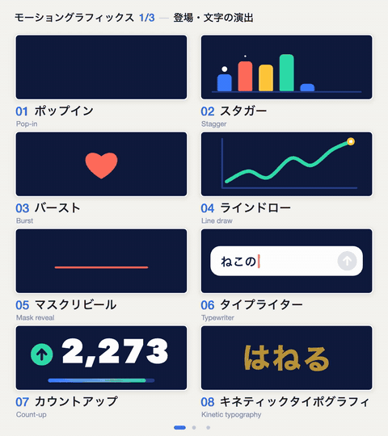

# 动效命名与样本库：Motion Prompt

## 直观预览

> 仓库官方预览 GIF（2026-11-11 取自仓库 assets）：motion 包前 8 个动效名（Pop-in、Stagger、Burst 等）各自循环播放的样子——这正是它的基本单元：一个名字 + 一段会动的样本。全部 192 个样本在在线画廊里逐个可看、可挑。

## 一句话价值

卡住你的往往不是没想法，是不知道那个动作叫什么：Motion Prompt 把 192 个"向 AI 点名要的东西"做成了带编号的词库——8 个包（动效、镜头、UI 组件、落地页效果、照片光影及各自第二辑）× 24 个，每个名字配会动的样本、一句含义、一句可抄的点单示例（五种语言含简体中文），还附一个 Agent Skill：画廊里勾选，AI 直接取规格和参考代码在你的项目里复刻。

## AI 选用指南

| 项目 | 选用说明 |
| --- | --- |
| 优先选用条件 | 做视频（Remotion/Canvas/AE）或网页动效时形容不出想要的动作；给视频生成模型（Veo 等）写镜头提示词缺术语；想让 Codex/Claude Code 照着样本编号精确复刻某个动效。 |
| 不适合或暂缓条件 | 只要一两个常见网页动效名时，先用库内 [动效命名词表](动效命名词表-9个常用网页动效-2026-11-02.md) 的 9 个就够，别为查词装整套；需要现成可复制的 CSS 过渡时用 Transitions.dev 那类实现库，本库给的是名字、样本与参考代码，不是组件库。 |
| 复用方式 | 三种：①查名单直接把名字（+时长/幅度/对象）写进提示词，零安装；②装 Skill（`npx skills add showheyohtaki/motion-prompt`）后说"打开 motion-prompt 库"，画廊勾选→Send to AI，Agent 只用你勾的编号复刻；③按编号点单，如"用 #012 和 #045"、"把 #032 的镜头改写成 Veo 的英文提示词"。 |
| 输入与产出 | 输入：编号或名字（或画廊勾选）→ 产出：该元素的规格 + 参考实现代码（纯 Canvas 函数）或可直接粘贴的提示词，由 Agent 按你的工程（Canvas/Remotion/CSS/AE/视频模型）落地。 |
| 首次读取入口 | 在线画廊 https://showheyohtaki.github.io/motion-prompt/ （全部样本会动）；名单在仓库 packs/ 各包 README（有简体中文版）；Skill 的命令面看仓库 README 的 Skill reference 一节。 |
| 同类选择依据 | 与 [动效命名词表](动效命名词表-9个常用网页动效-2026-11-02.md)：那张是单帖 9 个网页动效名（沟通急救），本库是 192 个跨动效/镜头/落地页/照片/UI 的系统词库加代码与 Skill（查词典）；与 [Lucian UX/UI Prompt](../../03-Codex能力/Skills/UI组件库与Agent-Skill-Lucian-UXUI-Prompt-2026-10-13.md)：同一发明（画廊+Skill，本项目 README 明说灵感与 CLI 结构都来自 Lucian），Lucian 管 UI 元素、本库管运动与镜头；与 [UI 元素命名视觉词典：NameThatUI](../组件/UI元素命名视觉词典-NameThatUI-2026-07-18.md)：NameThatUI 给 UI 元素静态命名，本库 ui 包给同批元素配了动效样本与点单示例。 |
| 接入前提与待核实项 | MIT（代码、视频、图片均可商用；引用元素代码须保留其首行署名注释）；Skill 需 Node 18+，脚本只读拉取静态数据（GitHub Pages 或 raw 兜底）、不上传项目内容，pick 时在本机 127.0.0.1 开临时监听收勾选结果；仓库 2026-10-14 建、约 1,887 星（2026-11-11），未在本机安装 Skill 实测。 |
| 检索词 | Motion Prompt、动效命名、动效词库、镜头语言、camera moves、motion graphics、点单式提示词、showheyohtaki、大滝昇平、Veo 提示词、Remotion 动效、Agent Skill |

> 核查记录：2026-11-11 读仓库 README 全文（264 行），并抽查 ui 包简体中文名单与 motion/camera/lp/photo 四包英文名单核对命名质量；星数与许可为当日 GitHub API 值。收藏不证明已安装、已运行或已获授权。

## 内容摘要

### 缘起（作者自述）

作者大滝昇平（Shohei Ohtaki，日本 Daytra 公司）在 X 上发了几条"给动效和镜头动作起名字"的短视频，评论里有一句点醒了他：**限制大家的不是想象力，是不知道这种运动叫什么名字**。于是他把"与 AI 协作所需的共同语言"做成可翻查的词库，并写下目标：让全世界多出更多能和 AI 一起干活的"创意总监"。仓库 2026-10-14 建，不到一个月 1,887 星。

### 词库构成：8 包 × 24 = 192 个名字

| 编号 | 包 | 内容举例（实查名单） |
| --- | --- | --- |
| 001–024 | motion 动效 | Pop-in、Stagger、Burst、Line draw、Mask reveal、Typewriter、Count-up、Kinetic typography |
| 025–048 | camera 镜头 | Pan、Tilt、Dolly in、Zoom in、Tracking shot、Orbit、Crane up、Dolly zoom（眩晕镜） |
| 049–072 | ui UI 组件 | 模态对话框、抽屉面板、底部面板、折叠面板、下拉选择框、Tooltip、Popover、Toast（中文名单质量实查过：示例带时长、幅度、变暗百分比等可执行参数） |
| 073–096 | lp 落地页效果 | Parallax scrolling、Fade-in on scroll、Sticky header、Pinning、Horizontal scroll、Scroll snap、Scroll progress bar |
| 097–120 | photo 照片光影 | Backlighting、Rim light、Silhouette、Split lighting、Rembrandt lighting、Butterfly lighting、Golden hour、Blue hour |
| 121–192 | motion2 / lp2 / camera2 | 上述三域的第二辑 |

每个条目统一四件套：**编号 + 名字 + 一句含义 + 一句"怎么向 AI 开口"的示例**；名单有英、日、西、简中、繁中五语版。每包视觉风格故意各不相同（motion 是深蓝四色、camera 是浅灰一蓝、lp 是白浏览器窗配朱红）——作者原话：一个包要做对的是名字，不是统一的家族脸。

### 三种用法与 Skill 的机制

1. **零安装查词**：翻名单或画廊找到名字，写进提示词，再补时长/强度/运动对象即可；对编程 AI、视频生成模型、甚至给真人的 brief 都成立。
2. **装 Skill 后勾选点单**：Skill 由 SKILL.md + 移植说明（references/porting.md）+ 一个只用 Node 标准库的脚本组成。说"打开库"，画廊在浏览器打开，你逐个按 Pick（可加一句备注如"用于片头标题"），按 Send to AI 后勾选经本机回环送达 Agent；Agent 判断你的工程怎么产出视频（Canvas/Remotion/CSS/AE/视频模型提示词），只取所勾编号的规格与参考代码复刻，**时间、缓动、幅度照原样，文字颜色图片换成你的**，回复末尾列明用了哪些编号、用在哪场、改了什么。知道编号也可跳过画廊直接报号。
3. **给自己的领域造同款词库**：make-your-own/ 给了三份可抄的提示词——翻译成另一种语言、为你自己的领域建一套名字样本、生成一页速查图。领域不限视频：灯光、声音、UI、摄影、烹饪、建筑都行，"知道名字才能开口要"在哪都成立。

实现细节见功力：每个元素就是一个纯函数 `cells[i](ctx, w, h, u)`，画面只取决于时间 u，不读时钟不用随机数——实时预览与逐帧渲染出的是同一批帧；零外部依赖；数据是静态文件（catalog.json / 每元素一个 txt），画廊与脚本共用，克隆到本地可离线用。

### 许可

MIT，连样本视频与图片都可商用；唯一动作是引用元素代码时保留首行署名注释（`// Motion Prompt #ID · MIT License (c) 2026 Shohei Ohtaki · …`）。

## 为什么值得收藏

- 它和动效命名词表是同一洞察的两种规模：那张卡是 9 个词的急救包，这件是 192 个词带样本、代码与 Skill 的词典——库里的动效线从此"查词"这一格有了工业级选项。
- "不知道叫什么"这个卡点在用户的多条线上都存在（给 Codex 描述界面、给视频模型描述镜头、给外包描述效果）；五语名单含简体中文，点单示例直接带参数，是能立刻用上的沟通基建。
- make-your-own 那套提示词是可迁移的方法：为任何领域沉淀"名字+样本+示例"词库——这正是 xiegao 的"大脑"与 bot 选材词汇在做的事，多了一个现成模板。

## 未来可以怎么用

- 做抖音/微博视频时先翻 camera 与 motion 两包点名镜头与动效，再写给剪辑或视频模型的 brief；README 自带把 #032 改写成 Veo 提示词的范例句式。
- 在 Codex 里装上 Skill，网页/看板项目要动效时让它开画廊勾选复刻，替代"让它活起来"式模糊描述。
- 给 bot 或 xiegao 沉淀自有词表时，套 make-your-own 的三段提示词与"编号+名字+含义+示例+样本"五件套结构。

## 原始内容 / 链接

- 仓库：https://github.com/showheyohtaki/motion-prompt （MIT，JavaScript）
- 画廊：https://showheyohtaki.github.io/motion-prompt/ ；他人分享的名字样本集：同站 /found.html
- 名单：仓库 packs/ 目录（每包五语 README）；社区可按 CONTRIBUTING 增包或增语种
- 起源帖（X，日语）：x.com/showheyohtaki 的三条原帖，链接见仓库 README「Original posts」
- 安装：`npx skills add showheyohtaki/motion-prompt`，或 Claude Code 插件市场 motion-prompt

## 相关联想

- [动效命名词表：让 AI 精准动起来的 9 个动效名](动效命名词表-9个常用网页动效-2026-11-02.md)：同题小卡——9 个网页动效急救词；本库是其系统化扩容（且 Stagger/Typewriter/Count-up 等词两边重合，可对照看粒度差）。
- [UI 组件库与 Agent Skill：Lucian UX/UI Prompt](../../03-Codex能力/Skills/UI组件库与Agent-Skill-Lucian-UXUI-Prompt-2026-10-13.md)：本项目的明示灵感源——"活画廊 + Agent Skill"的发明者；Lucian 给 UI 元素，本库给运动与镜头，CLI 命令集与静态数据布局都同源。
- [开源动作工作室工具链：22 个库拼出代码化视频管线](../../04-工具网站/开源项目/开源动作工作室工具链-22个库拼视频管线-2026-11-02.md)：管线解决"怎么做出来"，本库解决"怎么开口要"；Skill 的移植目标正包含 Remotion，与该管线的主干直接接上。
- [UI 元素命名视觉词典：NameThatUI](../组件/UI元素命名视觉词典-NameThatUI-2026-07-18.md)：静态命名词典；本库 ui 包是它的动态版（同批元素 + 动效样本 + 点单示例）。

## 适合反向调用的场景

- 我最近收藏了哪些相关内容？
- 这个项目可以借用什么素材？
- 有没有类似表达、结构、做法可以复用？
- 描述不出想要的动效/镜头/光影时，先翻本库画廊与名单点名，再写提示词。
- 要为某个领域沉淀术语词库时，调 make-your-own 三段提示词当模板。
