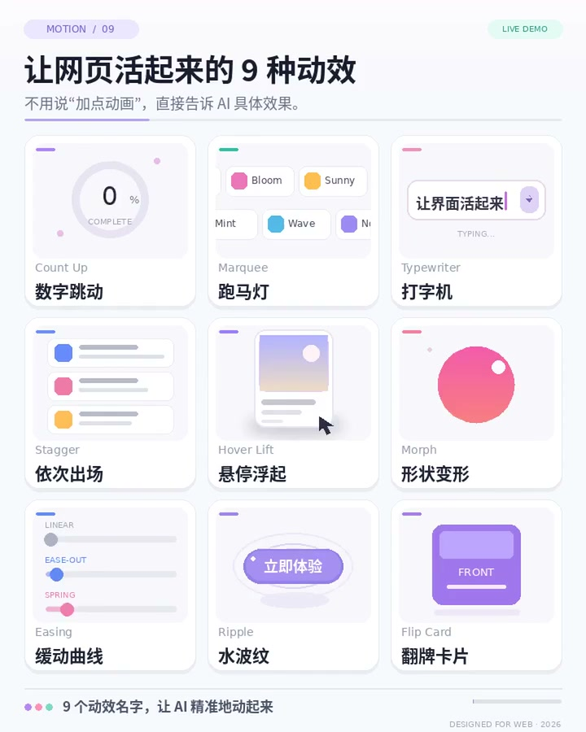

# 动效命名词表：让 AI 精准动起来的 9 个动效名

## 直观预览

> 原帖 16 秒演示视频的封面帧（720×900）：3×3 网格把 9 个动效各配了一个实时小演示——英文术语在上、中文俗名在下（Count Up 数字跳动、Marquee 跑马灯、Typewriter 打字机、Stagger 依次出场、Hover Lift 悬停浮起、Morph 形状变形、Easing 缓动曲线、Ripple 水波纹、Flip Card 翻牌卡片）。

## 一句话价值

给 AI 说"加点动画让它活起来"，结果满页乱飞——问题不在 AI，在没说清让哪一个动。这张词表把 9 个最常用的网页动效从口语描述对上标准英文名，再拼上一句"对象 + 动效名 + 缓动"的句式，动效指令就从许愿变成点菜。

## AI 选用指南

| 项目 | 选用说明 |
| --- | --- |
| 优先选用条件 | 让 coding agent 给页面加动效、改动效时，先查本表把口语需求换成标准术语再下指令；做落地页/看板的需求沟通时，用术语表和设计、开发对齐"到底要哪种动"。 |
| 不适合或暂缓条件 | 本表只是命名层，不含实现：具体怎么写看 [Motion](网页动画库-Motion-2026-08-22.md) 等实现卡；复杂动效（滚动驱动、布局动画、物理弹簧体系）不在这 9 个词覆盖内，别硬套。 |
| 复用方式 | 套用句式（对象 + 动效名 + 缓动方式，如"商品卡片加 Hover Lift，全部用 Ease-out"）；查词表把中文口语翻译成英文术语写进 prompt。 |
| 输入与产出 | 输入：一句口语描述（"数字跳上去""logo 一直跑"）→ 产出：可直接写进 prompt 的标准术语与组合句。 |
| 首次读取入口 | 本卡「内容摘要」的对照表；原帖附 16 秒视频，每个术语都有实时演示（链接见原始内容节）。 |
| 同类选择依据 | 与 [NameThatUI](../组件/UI元素命名视觉词典-NameThatUI-2026-07-18.md) 是姐妹卡：NameThatUI 管界面元素叫什么，本卡管动效叫什么，同属"命名层"；与 [Transitions.dev](Web过渡动效参考库-Transitions-dev-2026-07-07.md) 分工：它给过渡效果的现成参考与代码，本卡只负责把需求说准；与 [Fluid Functionalism](流体功能主义组件库-Fluid-Functionalism-2026-10-09.md) 分工：FF 是动效规范体系（三档 spring 等），本卡是入门沟通词汇。 |
| 接入前提与待核实项 | 9 个术语均为业界通用叫法（CSS/Motion/GSAP 文档同名），无许可问题；内容为单篇帖子的经验清单，未覆盖滚动视差、FLIP 布局动画等进阶动效，见内容摘要的边界注。 |
| 检索词 | 动效术语、动画命名、Count Up、Marquee、Typewriter、Stagger、Hover Lift、Morph、Easing、Ease-out、Ripple、Flip Card、让 AI 加动画、motion vocabulary、animation terms for prompts |

> 核查记录：2026-11-02 经公开接口读原帖全文并查看其视频封面帧逐格核对 9 个条目；帖子数据为查阅当日值。收藏不证明已安装、已运行或已获授权。

## 内容摘要

### 原帖的主张

作者 @awe0_io（AI Agent / LLM / 自托管方向的中文创作者）2026-11-01 发帖（查阅时约 1.39 万浏览 / 299 赞 / 227 收藏），配 16 秒视频。主张一句话：**跟 AI 描述动效要给名字，不要给感觉**——"加点动画，让它活起来"这种说法没指定对象和效果，AI 只能满页乱加；换成术语点名，结果立刻可控。

### 对照表（帖子原文的 9 对）

| 口语描述 | 标准名 | 用在哪 |
| --- | --- | --- |
| 数字从 0 一路跳上去 | Count Up | 首页数据、统计指标、价格 |
| 一排 Logo 一直往旁边跑 | Marquee | 合作品牌墙、公告条 |
| 字一个一个打出来 | Typewriter | hero 标语、AI 回答的打字感 |
| 一个接一个轮流出场 | Stagger | 列表、卡片组入场 |
| 鼠标移上去卡片浮起来 | Hover Lift | 商品卡、功能卡 |
| 形状慢慢变成另一个形状 | Morph | 图标/图形的状态切换 |
| 动作先快后慢很顺滑 | Easing | 一切动效的速度曲线（视频里细分 Linear / Ease-out / Spring 三档） |
| 按下去有一圈水波散开 | Ripple | 按钮点击反馈（Material 系经典） |
| 卡片翻过来看背面 | Flip Card | 卡片正反面信息 |

作者给的万用句（可直接抄的句式）：**"首页数字用 Count Up，合作品牌做 Marquee，商品卡片加 Hover Lift，全部用 Ease-out"**——对象、动效名、统一缓动，一句话三件都交代完。

### 深度注（整理者补充，与帖子原文分开）

- **为什么有效**：这 9 个词都是 CSS、Motion、GSAP 等主流实现库的原生词汇，模型在训练语料里见过无数次"术语→代码"的对应；口语描述则要模型先猜意图再猜实现，多一层猜就多一层跑偏。这和 NameThatUI 对组件做的事完全同构：命名层是人机协作最便宜的精度投资。
- **一个撞名警告**：Flip Card 只是"卡片翻面"；而动效领域还有个大词 **FLIP**（First / Last / Invert / Play，布局动画技术，Motion 的 layout 动画就基于它）——跟 AI 说"用 FLIP"和说"Flip Card"是两件完全不同的事，词表之外最容易翻车的就是这个。
- **覆盖边界**：这 9 个是网页微交互的入门层。帖子没覆盖但同样高频的还有：滚动触发与视差（Scroll Trigger / Parallax）、骨架屏闪烁（Shimmer）、弹跳入场（Pop / Spring）、退出动画——真要给 AI 下复杂动效指令时，需要在这张表之外再补词。

## 为什么值得收藏

- 它补的是库里动效收藏的**最上层**：库里有实现（Motion）、有规范（Fluid Functionalism）、有参考（Transitions.dev），唯独缺"怎么开口跟 AI 说"这一层；这张表虽小，恰好卡在每天都在发生的沟通动作上。
- 句式比词条更值钱："对象 + 动效名 + 缓动"是一个可迁移到所有视觉指令的表达模板——说清对象、点名效果、统一参数。
- 与 NameThatUI 组成命名层的一对：一个管静态元素叫什么，一个管动态效果叫什么，反向调用时可以一起给 agent 垫底。

## 未来可以怎么用

- 给 Codex/Muse 下页面动效需求前，先在本表把口语换成术语，再套万用句的句式发出去。
- 评审 AI 交回来的页面时，用这张表点名问题："入场不要全页 Stagger，只给卡片组"——比"感觉太乱"可执行得多。
- 以后遇到新的高频动效词（Shimmer、Parallax 等），往这张卡的对照表里续行，让它长成自己的动效词库。

## 原始内容 / 链接

- 原帖：https://x.com/awe0_io/status/2116895669428613390 （2026-11-01 22:10 CST 发布，附 16 秒演示视频；作者 @awe0_io）
- 帖子正文要点（原意转述）：跟 AI 说"加点动画，让它活起来"，结果整页每个东西都在飞，因为没讲清楚要让哪一个动；左边是你平常说的，右边是 AI 一听就懂的（即本卡对照表）；最常用的一句话即万用句。

## 相关联想

- [UI 元素命名视觉词典：NameThatUI](../组件/UI元素命名视觉词典-NameThatUI-2026-07-18.md)：姐妹卡，命名层的另一半——元素命名。本卡是动效命名。
- [网页动画库：Motion](网页动画库-Motion-2026-08-22.md)：实现层；本表点完名，Motion 负责把 Stagger、Easing、Hover 这些词落成代码。
- [Web 过渡动效参考库：Transitions.dev](Web过渡动效参考库-Transitions-dev-2026-07-07.md)：过渡效果参考；先用本卡说准要哪种过渡，再去它那挑具体效果。
- [流体功能主义组件库：Fluid Functionalism](流体功能主义组件库-Fluid-Functionalism-2026-10-09.md)：规范层；当动效从"点菜"升级到"全站统一规范"，接 FF 的三档 spring 体系。

## 适合反向调用的场景

- 我最近收藏了哪些相关内容？
- 这个项目可以借用什么素材？
- 有没有类似表达、结构、做法可以复用？
- 给 AI 写动效 prompt 前，先查本卡对照表换术语。
- 和设计/开发对齐动效需求时，把本卡当点名单用。
