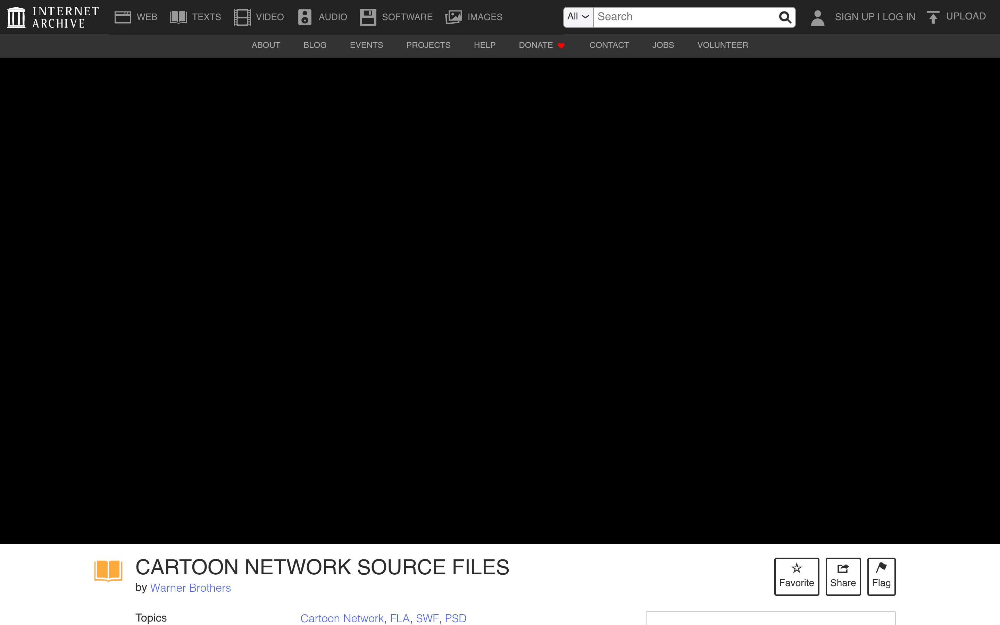

# CN 泄露链接清单的 archive.org 存档

## 直观预览

> archive.org 条目页：CARTOON NETWORK SOURCE FILES，署名 Warner Brothers，Topics：Cartoon Network / FLA / SWF / PSD。

## 一句话价值

泄露当天（2026-10-11）有人把 CN 泄露的 Google 文档链接清单转存到了 archive.org——Google 文档随时可能被删，这个存档是更持久的版本，还多了几个原版没有的链接。

## AI 选用指南

| 项目 | 选用说明 |
| --- | --- |
| 优先选用条件 | Google 文档版打不开/被删时，用这个存档版查链接清单。 |
| 不适合或暂缓条件 | 内容与 Google 文档版基本重复；条目是扫描文档的 OCR（含识别错位）；仅链接清单，无实际资产文件。 |
| 复用方式 | 链接收藏 |
| 输入与产出 | 存档页 → 泄露链接清单（全文 OCR 可读）。 |
| 首次读取入口 | [本卡](./CN泄露链接清单的archive-org存档-2026-10-12.md) →「内容摘要」；条目页 https://archive.org/details/document-sun-october-11-2026。 |
| 同类选择依据 | 与 [CN 泄露事件卡](./Cartoon-Network制作资产泄露事件-2026-10-12.md)：那篇是事件 + Google 文档版清单，这篇是同一清单的 archive.org 持久镜像。 |
| 接入前提与待核实项 | 上传者为匿名邮箱，署名 Warner Brothers 未证实；archive.org 条目可能被下架。 |
| 检索词 | cartoon network leaks archive.org 泄露存档 source files |

> 核查记录：整理于 2026-10-12，基于 archive.org 元数据 API + 全文 OCR 文本。未下载任何泄露文件。版权内容仅做链接与摘要。

## 内容摘要

- **条目**：archive.org/details/document-sun-october-11-2026，标题 "CARTOON NETWORK SOURCE FILES"，署名 Warner Brothers（上传者为匿名邮箱，未证实），2026-10-11 上传。
- **实质**：把 @dontmindmekdk 帖子里的 Google 文档（"cartoon network leaks"链接清单）转存成的扫描文档，附带 archive.org 自动生成的 PDF/EPUB/全文 OCR。
- **与 Google 文档版的差异**：多了几个原版没有的链接——archive.org/details/gumball-audio-hq、Smiling Friends 的 catbox 链接、Adventure Time 的额外 Drive 链接。
- **为什么存**：Google 文档可被作者删除或改链接，archive.org 版本是事件当天的冻结快照。

## 为什么值得收藏

1. **持久性**：泄露链接清单的 Google 文档随时可能消失，archive.org 是更硬的存档。
2. **版本差异**：存档版比我之前读的 Google 文档版多几个链接，是更全的版本。
3. **事件拼图**：和 CN 泄露事件卡、PPG 总表卡、风格指南卡一起，构成这次泄露事件的完整记录。

## 未来可以怎么用

- Google 文档版失效时，用这个查清单。
- 研究泄露事件传播时，这是当天的冻结证据。

## 原始内容 / 链接

- 条目：https://archive.org/details/document-sun-october-11-2026（2026-10-11 上传）
- 未下载任何泄露文件。

## 相关联想

- [Cartoon Network 制作资产泄露事件（X 爆帖）](./Cartoon-Network制作资产泄露事件-2026-10-12.md)：同一清单的 Google 文档版
- [飞天小女警官方美术风格指南泄露（Style Guide thread）](./飞天小女警官方美术风格指南泄露-2026-10-12.md)：同一波泄露潮

## 适合反向调用的场景

- CN 泄露的链接清单还有备份吗？
- Google 文档版打不开了怎么办？
