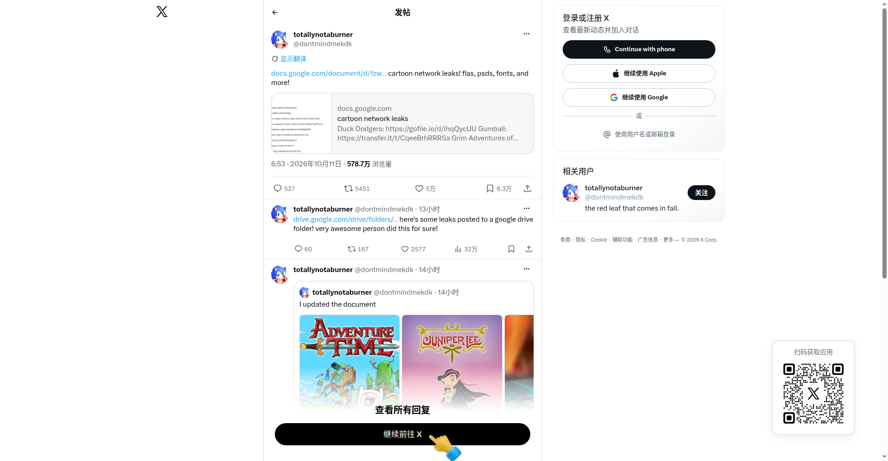

# Cartoon Network 制作资产泄露事件（X 爆帖）

## 直观预览

> X 帖子页面（@dontmindmekdk）：2026-10-11 发布，578.7 万浏览、5 万喜欢、6.3 万书签；附 Google 文档汇总链接和 Drive 文件夹。

## 一句话价值

2026-10-11 的 X 爆帖：有人公开分享据称泄露的 Cartoon Network 动画制作资产（FLA 工程文件、PSD、字体等），一份 Google 文档汇总了约 30 部作品的下载链接——职业动画的源文件长什么样、制作管线怎么组织，这是罕见的一手参考。

## AI 选用指南

| 项目 | 选用说明 |
| --- | --- |
| 优先选用条件 | 想看职业 2D 动画的源文件结构（FLA 分层、PSD 组织、字体用法）、标题字/logo 设计参考时。 |
| 不适合或暂缓条件 | 泄露来源不明、版权归属华纳；transfer.it/gofile 链接随时失效；**仅做链接+摘要收藏，不下载、不传播、不商用**。 |
| 复用方式 | 链接收藏、视觉参考 |
| 输入与产出 | X 帖 + Google 文档 → 了解泄露范围；源文件仅作学习参考。 |
| 首次读取入口 | [本卡](./Cartoon-Network制作资产泄露事件-2026-10-12.md) →「内容摘要」；原帖 https://x.com/dontmindmekdk/status/2109054667074256939。 |
| 同类选择依据 | 库内暂无同类动画制作资产；与品牌手册类（Luka brandbook）不同：这是制作源文件，不是规范文档。 |
| 接入前提与待核实项 | 泄露真实性未经官方证实；链接有效性随时间衰减；版权风险自负。 |
| 检索词 | Cartoon Network 泄露 动画制作资产 FLA PSD cartoon network leaks |

> 核查记录：整理于 2026-10-12，基于未登录浏览器完整读取 X 帖子 + 公开 Google 文档全文。未下载任何泄露文件。版权内容仅做链接与摘要。

## 内容摘要

- **事件**：@dontmindmekdk（totallynotaburner）2026-10-11 发帖，分享据称泄露的 Cartoon Network 动画制作资产，配文 "cartoon network leaks! flas, psds, fonts, and more!"。
- **汇总文档**：公开 Google 文档列出约 30 部作品的下载链接，包括《探险活宝》《飞天小女警》《德克斯特的实验室》《Gumball》《Regular Show》《Ed Edd n Eddy》《少年泰坦》《史酷比》《粉红豹》等，另有 torrent 种子和 Google Drive 备份文件夹。
- **传播**：578.7 万浏览、527 回复、5451 转帖、5 万喜欢、6.3 万书签——动画圈的现象级传播。
- **作者补充**：评论区追加 Drive 文件夹链接，并更新了文档内容，附多张动画标题图。

## 为什么值得收藏

1. **职业动画源文件罕见**：FLA 工程文件、PSD 分层、字体——大厂动画怎么做分层和资产管理，平时看不到。
2. **标题字设计参考**：探险活宝、Juniper Lee 等标题 logo 的源文件，字体设计学习价值高。
3. **时效性记录**：这类泄露链接存活期短，卡片先把"发生过什么"记下来。

## 未来可以怎么用

- 学 2D 动画分层/资产组织时，找对应的源文件看结构。
- 标题字设计找灵感（仅学习，不商用）。
- 链接失效是常态，需要时先验证再行动。

## 原始内容 / 链接

- 原帖：https://x.com/dontmindmekdk/status/2109054667074256939（2026-10-11，578.7万浏览）
- 汇总文档（公开）：https://docs.google.com/document/d/1zwCuFou1Af97LAfyLRaJdn2TuOtjdTcdAFd6IZf-jpQ/edit?usp=sharing
- 未下载任何泄露文件；未验证泄露真实性。

## 相关联想

- [概念品牌手册：Luka brandbook](./概念品牌手册-Luka-brandbook-2026-10-09.md)：品牌规范文档 vs 动画制作源文件——两种"设计资产"的不同形态

## 适合反向调用的场景

- 职业动画的 FLA/PSD 源文件长什么样？
- 动画标题字设计有参考吗？
- 之前那个 Cartoon Network 泄露是什么？
