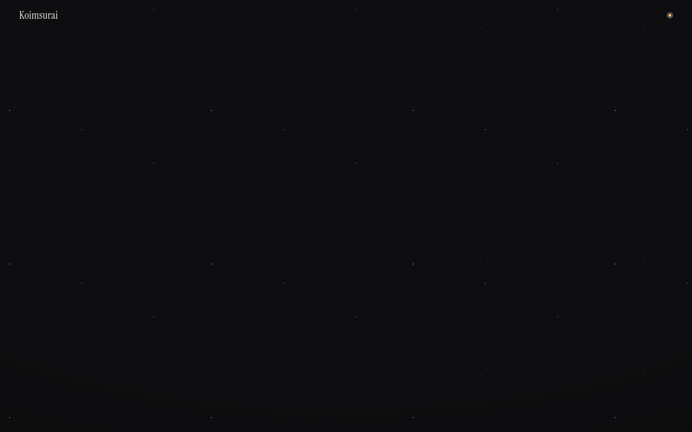
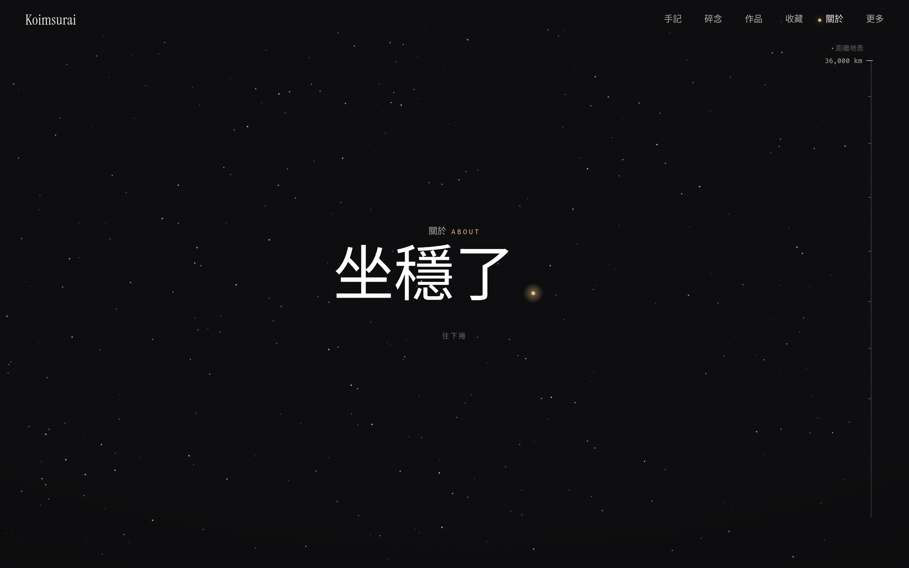

# 个人网站设计：宙と木 Koimsurai

## 直观预览

> 上：首页——黑色星空（轨道星场），左上 Koimsurai 衬线字标，右上角唯一的琥珀色圆点就是全站的「信号」。下：關於页开头。

## 一句话价值

一个 2004 年生的台湾开发者给自己造的个人星球：整站只有三种「材料」——黑是纸、白是墨、琥珀是信号（且只许出现在一个点上）；About 页写成一次向地心的下潜（地表 → 第一层 → 地心），导航是六分仪测星。是「设计语言先行、克制到偏执」的个人站范本。

## AI 选用指南

| 项目 | 选用说明 |
| --- | --- |
| 优先选用条件 | 做个人站/博客想要一套能自圆其说的暗色设计语言时，先读这张卡的「内容摘要」里作者自述的三材料规则和下潜叙事，再决定借哪一条。 |
| 不适合或暂缓条件 | 这是强个人风格的成品站，不是组件库：借规则（信号色纪律、叙事结构）可以，整站照搬版式会和自己的内容气质打架。 |
| 复用方式 | 链接收藏 |
| 输入与产出 | 站点浏览 → 可迁移的设计规则（配色纪律、About 叙事骨架、colophon 写法）。 |
| 首次读取入口 | 本站 https://koimsurai.com/ ；设计自述在「此站點」页 https://koimsurai.com/about-site ；作者经历在 https://koimsurai.com/about 。 |
| 同类选择依据 | 与 [概念品牌手册：Luka brandbook](./概念品牌手册-Luka-brandbook-2026-10-09.md)：Luka 是品牌规范文档，这站是把规范活成成品站；与 Lucian UX/UI Prompt：那边是亮色组件画廊，这边是暗色编辑型个人站，正好两个极端。 |
| 接入前提与待核实项 | 站点为 React SPA，内容靠 JS 渲染，普通抓取只能读到部分文本；作者技术栈细节来自其 About 页自述。 |
| 检索词 | koimsurai 宙と木 个人网站 黑纸白墨 琥珀 信号色 六分仪 |

> 核查记录：整理于 2026-10-27，基于首页、關於页、此站點（colophon）页原文与站点源码中的构建信息。未与作者联系。

## 内容摘要

- **作者**：Koimsurai，2004 年生于台湾云林，水瓶座；现为微星科技（MSI）软件工程师（Tauri / Vite / React 前端 + Rust 后端），此前做过日本料理店内外场、程式教育讲师、补习班 App 前端，大学专题是 EV 充电整合 VoltiCar。站点自述：「一個寫代碼的人，偶爾造點東西。」
- **站点结构**：手記 NOTES、碎念 MOMENTS、作品 WORK、收藏 COLLECTION、關於 ABOUT，外加設備、航行日誌、留言、照片、朋友、此站點——老派个人站的全套栏目，用航海/天文词汇重新命名。
- **设计系统（作者在 colophon 页自述）**：「此處無他，唯有黑夜、白墨與微光。」材料只有三样：**黑是纸、白是墨、琥珀是信号**。琥珀只出现在一个点上——「你在哪裡、正在發生的事」，明确不拿来当大面积强调色。首页右上角那颗小琥珀点就是这条规则的实体。
- **交互隐喻**：首页是轨道星场，「點一顆星，六分儀會轉過去測它」——点一颗星，六分仪（航海测角仪器）会转过去测它；导航与定位被写成观星。
- **About 页叙事**：开场「坐穩了。往下捲」，然后按人生时间线一路向下：地表（技能全表）→ 第一层（做过的事）→ 地心（「再往下，是還沒寫下的事」），滚动 = 下潜，深度 = 人生层次。
- **技术**：React SPA（Vite 系构建、TanStack Router、i18n 多语言、homeOrbit 星场模块、页面转场），与作者主业技术栈一致。

## 为什么值得收藏

1. **信号色纪律是可直接偷的规则**：强调色只许出现在「当前位置/正在发生」一个点上，其余全靠黑白灰阶——比「主色+辅色」的常规配色法更狠，也更适合看板类页面（状态信号天然只有一个焦点）。
2. **About 页的下潜结构**：把简历时间线改写成地层剖面，滚动动作本身成了叙事；给任何「关于我/更新日志/项目史」页面提供了一个不用插画也能成立的骨架。
3. **colophon 页这个品类本身**：「此站點」页公开材料、规则和隐喻——个人站把自己的设计系统写成一页说明书，既是态度也是文档；和 Luka 的 brand JSON 是同一件事的两种形态（给人看的 vs 给 agent 看的）。

## 未来可以怎么用

- wuyu.uk 或以后任何个人站改版时，先拿这三条规则当约束清单：只留黑白 + 一个信号色、信号色只标「当前」、长页用单一隐喻贯穿滚动。
- 做状态看板时参考琥珀点的用法：全局只允许一个「正在发生」的视觉焦点。

## 原始内容 / 链接

- 站点：https://koimsurai.com/
- 设计自述：https://koimsurai.com/about-site
- 作者经历：https://koimsurai.com/about

## 相关联想

- [概念品牌手册：Luka brandbook](./概念品牌手册-Luka-brandbook-2026-10-09.md)：品牌规范文档形态
- [可交互 UI 组件库与 Agent Skill：Lucian UX/UI Prompt](../03-Codex能力/Skills/UI组件库与Agent-Skill-Lucian-UXUI-Prompt-2026-10-13.md)：亮色组件画廊，正好对照

## 适合反向调用的场景

- 有没有把设计系统写成 colophon 的个人站参考？
- 信号色/强调色克制使用的范本是哪张卡？
- About 页除了时间线还能怎么写？
