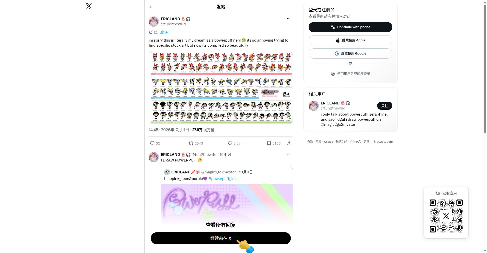

# 飞天小女警官方画风素材总表（Powerpuff Girls Core Style Guide）

## 直观预览

> X 帖子页面（@fun2thewrld，ERICLAND）：2026-10-11 发布，27.6 万浏览、2.5 万喜欢；配图为三位主角的官方画风素材总表。

## 一句话价值

一张把飞天小女警三位主角（花花/泡泡/毛毛）官方画风素材整理成总表的图：按红/蓝/绿三行排列大量头部特写与全身姿势，带 "POWERPUFF GIRLS CORE STYLE GUIDE" 字样和 CN 标识——画 Q 版角色、做表情姿势库时的现成参考。

## AI 选用指南

| 项目 | 选用说明 |
| --- | --- |
| 优先选用条件 | 需要 Q 版角色三头身比例、表情差分、姿势参考；做飞天小女警同人/致敬设计时。 |
| 不适合或暂缓条件 | 单张图片，无源文件；版权归属华纳，仅学习参考不商用。 |
| 复用方式 | 视觉参考 |
| 输入与产出 | 总表图片 → 角色比例/表情/姿势参考。 |
| 首次读取入口 | [本卡](./飞天小女警官方画风素材总表-2026-10-12.md) →「内容摘要」；原帖 https://x.com/fun2thewrld/status/2109173646954778867。 |
| 同类选择依据 | 与 [CN 泄露事件卡](./Cartoon-Network制作资产泄露事件-2026-10-12.md)的关系：同一波泄露潮流出的 Powerpuff Girls 素材在粉丝圈的传播形态——那篇是源文件，这篇是整理好的总表图。 |
| 接入前提与待核实项 | 图片来源疑似泄露资产流出，真实性未证实；仅学习参考。 |
| 检索词 | Powerpuff Girls 飞天小女警 style guide 角色设计 素材总表 |

> 核查记录：整理于 2026-10-12，基于未登录浏览器完整读取 X 帖子。帖中无外部链接。版权内容仅做链接与摘要。

## 内容摘要

- **帖子**：@fun2thewrld（ERICLAND，飞天小女警资深粉丝/画手）2026-10-11 发帖，配文大意：作为 PPG 宅，平时很难找到想要的特定官方素材图，这张整理得如此精美的合集简直是梦想成真。
- **配图**：一张 "POWERPUFF GIRLS CORE STYLE GUIDE" 总表——花花（红粉）、泡泡（蓝）、毛毛（绿）三行，整齐排列大量头部特写与全身姿势，官方画风，带 Cartoon Network 标识。
- **传播**：27.6 万浏览、32 回复、2543 转帖、2.5 万喜欢、6106 书签。
- **作者**：自回复 "I DRAW POWERPUFF"，另有绘画账号 @magic2go2mystar。

## 为什么值得收藏

1. **Q 版角色教科书**：三头身比例、标志性发型（花花蝴蝶结/泡泡双马尾/毛毛短发）、表情差分，一张图看全。
2. **和 CN 泄露潮同源**：疑似泄露资产在粉丝圈的整理传播形态，和 [CN 泄露事件卡](./Cartoon-Network制作资产泄露事件-2026-10-12.md)互为佐证。
3. **AI 生图参考**：要 AI 画 Q 版角色时，这种官方总表是最好的风格锚点。

## 未来可以怎么用

- 画 Q 版角色/表情包时照着找比例和表情。
- AI 生图做 Q 版风格时，把这张图当风格参考喂给模型。
- 和 CN 泄露的 PPG 源文件对照看（总表 vs 源文件）。

## 原始内容 / 链接

- 原帖：https://x.com/fun2thewrld/status/2109173646954778867（2026-10-11，27.6万浏览）
- 帖中无外部链接；未下载原图。

## 相关联想

- [Cartoon Network 制作资产泄露事件（X 爆帖）](./Cartoon-Network制作资产泄露事件-2026-10-12.md)：同一波泄露潮——那篇是制作源文件，这篇是粉丝圈整理的总表图

## 适合反向调用的场景

- Q 版角色比例/表情有参考图吗？
- 飞天小女警的官方素材总表在哪？
- AI 画 Q 版风格拿什么当参考？
