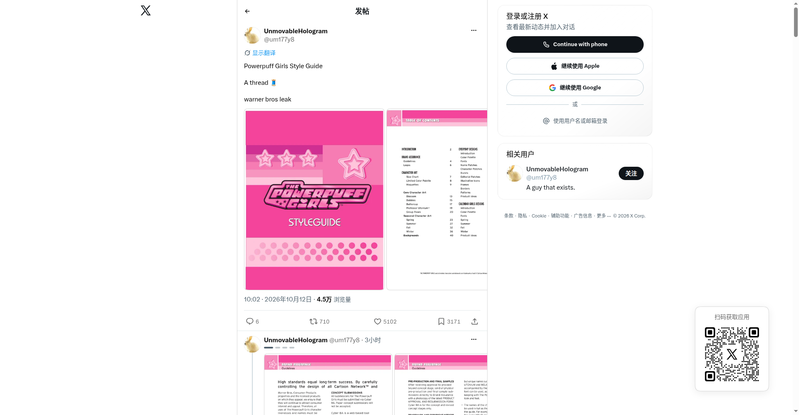
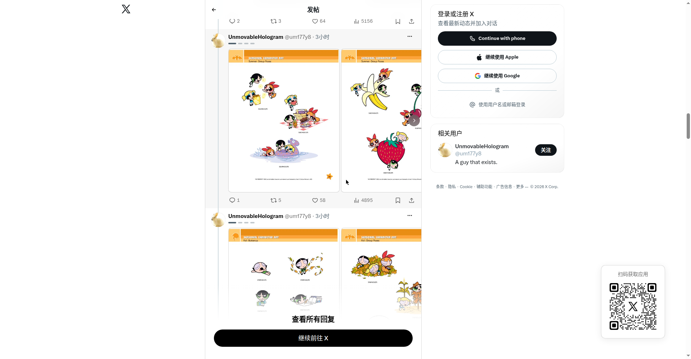

# 飞天小女警官方美术风格指南泄露（Style Guide thread）

## 直观预览

> X thread（@um177y8，UnmovableHologram）：2026-10-12 发布，"Powerpuff Girls Style Guide / A thread / warner bros leak"；4.5 万浏览、5102 喜欢。图1：风格指南封面 + 目录页；图2：夏季/秋季主题角色变体页。

## 一句话价值

泄露的华纳官方《飞天小女警》美术风格指南全本 thread：不止是角色图，更是一份完整品牌规范手册的目录结构——品牌保证、角色美术（身高比例/限定色板/雕塑转面）、季节变体、背景设定，大厂风格指南"长什么样"看这一套就够了。

## AI 选用指南

| 项目 | 选用说明 |
| --- | --- |
| 优先选用条件 | 想看官方风格指南的完整结构（写自己品牌的规范时照抄章节）；角色身高比例、季节变体、背景设定的参考。 |
| 不适合或暂缓条件 | 泄露来源不明、版权归属华纳；仅学习参考，不商用不传播。 |
| 复用方式 | 结构参考、视觉参考 |
| 输入与产出 | 风格指南目录结构 → 自己品牌手册的章节框架。 |
| 首次读取入口 | [本卡](./飞天小女警官方美术风格指南泄露-2026-10-12.md) →「内容摘要」；原帖 https://x.com/um177y8/status/2109464681152979020。 |
| 同类选择依据 | 与 [PPG 素材总表](./飞天小女警官方画风素材总表-2026-10-12.md)：那篇是单张总表图（粉丝整理），这篇是官方手册全本 thread（含目录结构）；与 [Luka brandbook](./概念品牌手册-Luka-brandbook-2026-10-09.md)：都是"品牌规范"，一个是大厂官方实物，一个是概念项目——对照看规范怎么写。 |
| 接入前提与待核实项 | 泄露真实性未经官方证实；thread 尾部被登录墙遮挡，未看全。 |
| 检索词 | Powerpuff Girls Style Guide 风格指南 品牌手册 角色设定 warner bros leak |

> 核查记录：整理于 2026-10-12，基于未登录浏览器完整读取 X 帖子及 thread（尾部被登录墙遮挡）。帖中无外部链接。版权内容仅做链接与摘要。

## 内容摘要

- **帖子**：@um177y8（UnmovableHologram）2026-10-12 连发 thread，正文仅三行："Powerpuff Girls Style Guide / A thread 🧵 / warner bros leak"。
- **内容**：疑似泄露的华纳官方 PPG 美术风格指南扫描图，逐帖展示：
  - 封面 "CHARACTER ART" + 完整目录页
  - 主角三人组身高比例对照图
  - Blossom / Bubbles / Buttercup 的 MAQUETTES（雕塑转面参考）
  - Professor Utonium 角色立绘、三人组合姿势
  - 春/夏/秋季主题角色变体立绘（夏季：香蕉/草莓/野餐/游泳主题；秋季：落叶主题）
  - 多页城市背景（BACKGROUNDS）设定图
- **目录结构**（官方风格指南的章节框架，抄作业用）：
  - INTRODUCTION → BRAND ASSURANCE（Guidelines / Logos / Name Patches / Character Patches / Fonts）→ CHARACTER ART（Size Chart / Limited Color Palette / Maquettes / Core Character Art 按角色分 / Group Poses / Seasonal Character Art 按季节分）→ BACKGROUNDS → EVERYDAY DESIGNS / CALENDAR DESIGNS
- **传播**：4.5 万浏览、6 回复、710 转帖、5102 喜欢、3171 书签。

## 为什么值得收藏

1. **官方风格指南的"目录"本身就是教材**：Brand Assurance → Character Art → Backgrounds 的三段式，和 [Luka brandbook](./概念品牌手册-Luka-brandbook-2026-10-09.md) 对照看——大厂实物 vs 概念项目，规范怎么写一目了然。
2. **DESIGN_SKILL.md 的参照**：他想把品牌规范写成 skill，这份就是"规范"长什么样子的真实样本（Limited Color Palette、Size Chart 都是 agent 可读的约束）。
3. **季节变体**：同一角色春夏秋冬四套变体的官方做法，角色 IP 运营的参考。

## 未来可以怎么用

- 写自己品牌/项目的风格指南时，照这个目录结构搭章节。
- 把 Limited Color Palette / Size Chart 这类"硬约束"写法，抄进 DESIGN_SKILL.md。
- 和 Luka brandbook、Amir Design Judgment 组成"规范三件套"对照学习。

## 原始内容 / 链接

- 原帖：https://x.com/um177y8/status/2109464681152979020（2026-10-12，4.5万浏览）
- 帖中无外部链接；thread 尾部被登录墙遮挡。

## 相关联想

- [飞天小女警官方画风素材总表（Powerpuff Girls Core Style Guide）](./飞天小女警官方画风素材总表-2026-10-12.md)：单张总表图 vs 全本手册 thread
- [Cartoon Network 制作资产泄露事件（X 爆帖）](./Cartoon-Network制作资产泄露事件-2026-10-12.md)：同一波泄露潮的源文件
- [概念品牌手册：Luka brandbook](./概念品牌手册-Luka-brandbook-2026-10-09.md)：品牌规范的两种形态对照

## 适合反向调用的场景

- 官方风格指南的目录结构长什么样？
- 品牌手册分哪几个章节？
- 飞天小女警的季节变体设定？
