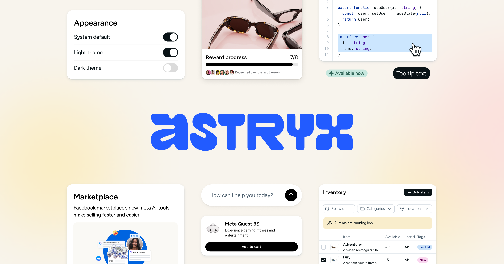

# Meta 开源设计系统：Astryx

## 直观预览

> 仓库官方横幅（2026-11-09 取自 README）：蓝色 Astryx 字标被真实组件卡片环绕——外观开关、奖励进度卡、代码片段、Marketplace 卡、AI 输入框、库存表，一张图同时展示了它的组件面与"给人也给 Agent 看"的定位。未在本机安装实测。

## 一句话价值

Meta 在内部用了八年、撑起 13,000+ 应用的最大设计系统开源了（150+ 无障碍组件、7 套主题、模板与 CLI，MIT）；它真正的开创性不在组件数量，而在把"人和 AI 用同一套工具、同一份文档干活"写进系统设计——CLI 自带给 Agent 读的能力清单（manifest），是"Agent 时代设计系统"的第一份完整参考实现。

## AI 选用指南

| 项目 | 选用说明 |
| --- | --- |
| 优先选用条件 | 新开 React 19 项目要一套完整设计系统（组件+主题+页面模式+模板）且希望 AI 编程助手能自己查文档、自己选组件时；研究"怎么把工具体系做成 Agent 友好"时当范本拆解。 |
| 不适合或暂缓条件 | 非 React 项目用不上（目前只有 React 实现）；项目还在 React 18 的先别升；需要稳定图表组件的注意：其图表包（vega/charts）只有 canary 版、无稳定发布。整体仍是 Beta。 |
| 复用方式 | 安装依赖（`@astryxdesign/core` + 一套 `@astryxdesign/theme-*` + `@astryxdesign/cli`）；全局装 CLI 后让本机所有 coding agent 共用；主题靠 CSS 变量覆写定制；组件不够深时用 swizzle 把源码弹进自己项目自持。 |
| 输入与产出 | 输入：React 19 项目 → 产出：150+ 类型化组件、品牌级主题（含暗色）、现成页面模板与模式（表格页/详情页/表单向导/导航/数据录入）。 |
| 首次读取入口 | 仓库 README 与 `packages/core/README.md`（快速上手）；CLI 的一切以 `astryx manifest --json` 与 `astryx docs` 为准（打印的是已安装版本自己的文档，不会读到过期网页文档）。 |
| 同类选择依据 | 与 [开放代码组件基座：shadcn/ui](开放代码组件基座-shadcn-ui-2026-09-27.md)：shadcn 是"复制源码自己养"的组件集，Astryx 是带主题、模式、模板、CLI 的完整系统，且 swizzle 把 shadcn 式自持做成了系统内功能；与 [Dashboard 设计系统：BoardUI](Dashboard设计系统-BoardUI-2026-07-09.md)：BoardUI 只管仪表盘一类界面，Astryx 是全产品面。选型口诀：要全套系统与 Agent 协作选 Astryx，只要源码自由拼装选 shadcn。 |
| 接入前提与待核实项 | MIT；仓库 2026-01-09 建、约 16,151 星（2026-11-09），推送活跃；状态 Beta，未在本机安装验证。硬前提：React 19+（react/react-dom 为 peer），样式消费端只需预构建 CSS、无需构建插件，但需装 @stylexjs/stylex peer。 |
| 检索词 | Astryx、Meta 设计系统、design system、StyleX、React 19、agent ready、swizzle、astryxdesign、能力清单、manifest、主题系统、组件库选型 |

> 核查记录：2026-11-09 读仓库 README 全文（155 行）、CLI 包 README（747 行，重点读 manifest/search/doctor 章节）；星数、许可、时间均为当日 GitHub API 值。收藏不证明已安装、已运行或已获授权。

## 内容摘要

### 出身与规模

Astryx 在 Meta 内部生长了八年，是公司使用最广、规模最大的设计系统，支撑 13,000+ 应用，由实际依赖它的工程师、设计师与产品团队共同 shaping。2026 年 1 月开源，目前 Beta。技术底座是 React 19 + StyleX（Meta 自己的样式方案），但消费端无感：导入预构建 CSS、用类型化 React 组件，不需要构建插件、不需要接任何样式库。

### 四个差异化设计

- **开放内部（open internals）**：组件按可组合层级构建，底层积木直接导出，不锁死在顶层 API 后面；再深一层，`swizzle` 把组件完整源码弹射进你的项目归你自持——等于把 shadcn 的"源码自持"做成了官方功能。
- **不锁样式**：内部用 StyleX 写，对外不可见；覆写样式用你项目已有的 Tailwind、CSS Modules 或纯 CSS 的 className 即可。
- **主题即 CSS 变量**：换品牌不动组件源码，只覆写一组 CSS 自定义属性；官方 7 套现成主题（neutral、butter、chocolate、matcha、stone、gothic、y2k）全部可继续深改，自带暗色模式。
- **为人也为 Agent 建**：API、文档、CLI 一起设计，让人和 AI 助手用同一种方式构建——这是它区别于所有传统设计系统的地方，下一节展开。

### Agent 友好到底做了什么（本卡重点）

它的 CLI（@astryxdesign/cli）不是给人敲的命令集合，而是一套给 Agent 发现的接口：

- **能力清单 manifest**：`astryx manifest --json` 一次返回全部命令、参数、选项类型/可选值/默认值、是否支持 --json、响应类型判别符与退出码——README 原话是把它当作"CLI 界面的 OpenAPI"。Agent 不用爬 --help 文本猜。
- **文档自带、版本对齐**：`astryx docs <路径>` 直接打印已安装版本自己的文档树；全局装一份后本机每个 coding agent 都认识 Astryx，进了项目又自动用项目自己的版本，永远不会读到与代码版本对不上的网页文档。
- **统一搜索**：`astryx search button` 一次跨组件、hooks、文档、模板、主题检索，带相关性排序与容错，每条结果附"下一步该敲的命令"。
- **类型化 JSON 信封与错误码**：所有 --json 输出是 `{apiVersion, type, data}` 信封，错误有稳定错误码（如 ERR_PROJECT_REQUIRED），Agent 能编程式处理成败。
- **doctor 与缺口上报**：`doctor` 诊断项目与集成包、可作 CI 门禁；`gap-report` 在缺组件/功能时直接向拥有它的包上报缺口——连"发现系统不够用"都有正规通道。
- 还有 upgrade codemod（升级后自动改你的代码）、integrations（第三方可按 manifest 规范给它扩包）、build 命令（给模板或工作流 playbook 起一个页面）。

与此呼应的四条官方原则：指引优于强制（组件给能力不跟人对着干，你传什么值就渲染什么）；强约定且全文档化（命名、props、组合规则全系统一致，学会几个就全通——对人可预测，对 Agent 同样可预测）；人机同一套系统（"每个让 Astryx 对 AI 更易用的改动，也同时让它对人更易用"）；用测量赢得结论（约定靠测试不靠断言）。

### 体系结构

三层：Foundations（排版、颜色、布局、无障碍）→ Components（150+ 带完整 TS 支持的组件）→ Patterns（表格页、详情页布局、表单向导、导航、数据录入等实战模式）。包：core（组件+主题系统）、cli、build（StyleX 源码构建插件）、theme-*（7 套主题）；lab 为内部实验包未发布，vega/charts 图表仅 canary。

## 为什么值得收藏

- 它是目前唯一把"Agent 是一等公民用户"落到工程细节（manifest、版本对齐文档、JSON 信封、缺口上报）的大厂设计系统——用户自己的全部产品都是靠 Agent 构建的，这套范式比组件本身更值得学。
- 出身硬：八年内部实战、13,000+ 应用验证，不是发布会 PPT 产品；开源后 10 个月 1.6 万星、迭代活跃（收藏前一日仍在推送）。
- 与库内 shadcn/ui、BoardUI、brands-design-md 正好拼成"Agent 时代前端基建"四角：组件基座、看板系统、品牌上下文、完整设计系统。

## 未来可以怎么用

- xiegao2.0 或后续 React 新项目选型时，把它列为设计系统候选与 shadcn 路线正面对比：要全套（主题/模式/模板/CLI）还是要轻量自持，试一个真实页面再定。
- 给自己的工具/看板写 CLI 或文档时，直接借它的 Agent 友好四件套：manifest 自描述、docs 随版本走、--json 信封 + 错误码、search 一口查全域。
- 评审任何"AI 友好"宣称的产品时，用它的具体做法当标尺追问：你的 manifest 在哪？文档怎么保证与版本对齐？

## 原始内容 / 链接

- 仓库：https://github.com/meta/astryx （MIT，TypeScript）
- 文档：https://astryx.atmeta.com ；Storybook：https://astryx.atmeta.com/storybook/ ；Sandbox：https://astryx.atmeta.com/sandbox/
- npm：@astryxdesign/core、@astryxdesign/cli、@astryxdesign/theme-*（neutral/butter/chocolate/matcha/stone/gothic/y2k）
- 贡献与约定：仓库 Wiki（API Conventions / Design Conventions / Component Lifecycle）；社区在 Discord。

## 相关联想

- [开放代码组件基座：shadcn/ui](开放代码组件基座-shadcn-ui-2026-09-27.md)：源码自持路线；Astryx 的 swizzle 与 upgrade（甚至能刷新 shadcn 复制来的组件）在系统内接住了这条路线。
- [Dashboard 设计系统：BoardUI](Dashboard设计系统-BoardUI-2026-07-09.md)：单一场景（仪表盘）的设计系统，与 Astryx 的全产品面对照着看粒度差异。
- [品牌设计上下文参考库：brands-design-md](../灵感库/品牌设计上下文参考库-brands-design-md-2026-08-03.md)：它管"把品牌上下文喂给 Agent"，Astryx 管"Agent 直接调用的组件与文档"，是同一条 Agent 构建链的上下文端与执行端。

## 适合反向调用的场景

- 我最近收藏了哪些相关内容？
- 这个项目可以借用什么素材？
- 有没有类似表达、结构、做法可以复用？
- 新开 React 项目选设计系统时，先读本卡的选型口诀与硬前提（React 19、Beta、图表未稳定）。
- 设计任何给 Agent 用的 CLI/文档体系时，调本卡「Agent 友好」一节逐项对照。
