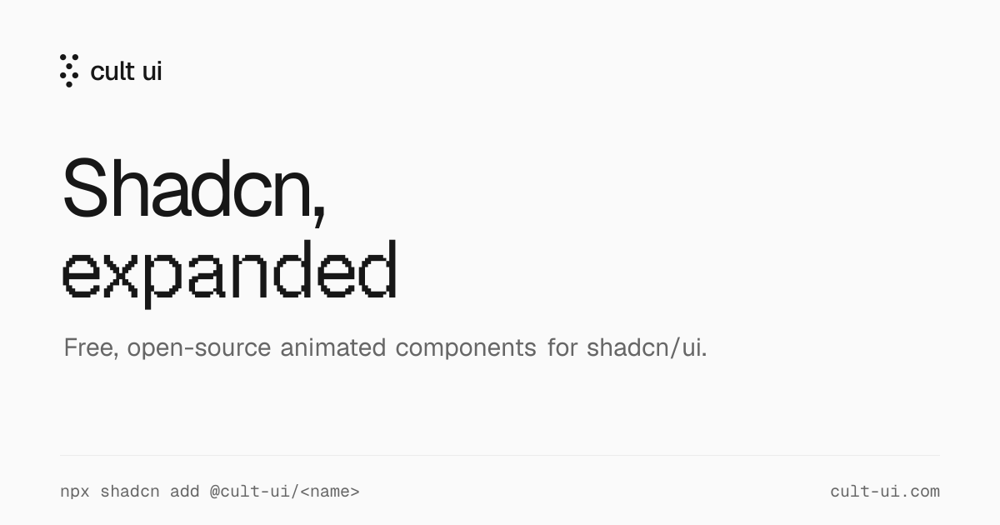

# shadcn 动画组件库：Cult UI

## 直观预览

> 官网 OG 图（2026-11-15 取）：它给自己的定位就印在图上——"Shadcn, expanded"，免费开源的 shadcn/ui 动画组件扩展，底部就是安装命令 `npx shadcn add @cult-ui/<name>`。组件实物在官网逐个有动态演示，本图为品牌图。未在本机安装实测。

## 一句话价值

shadcn/ui 官方组件偏克制、缺"有设计感的动画件"，Cult UI 就是来补这一格的：150+ 全免费的动画组件（近期一次加了 58 个），全部做成 shadcn registry 条目，一条命令把源码拷进你的项目归你自持；面向"设计工程师"的口味——Dynamic Island、Dock、纹理渐变、设备样机、看板这类官方库不会做的件，它全有。

## AI 选用指南

| 项目 | 选用说明 |
| --- | --- |
| 优先选用条件 | 项目已经是 shadcn/ui + Tailwind 技术栈，想快速补一批有质感的动画组件、区块或落地页件，不想自己从零调动效；给 AI 搭原型时要现成的"好看件"拼装。 |
| 不适合或暂缓条件 | 不用 shadcn/Tailwind 的项目先别引（组件吃 Tailwind v4 与 shadcn 主题 token）；要完整设计系统（主题/模式/治理）时用 [Astryx](Meta开源设计系统-Astryx-2026-11-09.md)，本库是组件集不是系统；动效敏感、要极度克制的产品面慎选重口味件，按需挑单个装。 |
| 复用方式 | 注册命名空间后按名安装：components.json 里加 `"@cult-ui": "https://www.cult-ui.com/r/{name}.json"`，再 `npx shadcn@latest add @cult-ui/<name>`；也可直接按 URL 装单个 JSON。装完源码在自己仓库里，随便改。 |
| 输入与产出 | 输入：组件名 → 产出：该组件 TSX 源码 + 其依赖清单（每页文档都标了依赖），多数动效由 Motion 驱动。 |
| 首次读取入口 | 官网组件目录 https://www.cult-ui.com/docs/components/ ；给 Agent 读的入口是 llms.txt / llms-full.txt，或任意文档 URL 后加 .md 取干净 Markdown。 |
| 同类选择依据 | 同架竞品里它的差异：与 [SmoothUI](Shadcn动画React组件库-SmoothUI-2026-08-22.md) 比——SmoothUI 有 Free/Pro 分层，Cult UI 150+ 全部免费且量更大、更新更勤（2024 年至今全职维护）；与 [Great UI](动画React组件源码库-Great-UI-2026-09-22.md) 比——Great UI 以复制源码翻源码为主，Cult UI 是 registry 原生分发（命名空间一条命令）且有 MCP server 让 Agent 自己搜装；根基同为 [shadcn/ui](开放代码组件基座-shadcn-ui-2026-09-27.md)，都不与官方重复造轮子，专补官方没有的动画与展示件。 |
| 接入前提与待核实项 | MIT（组件、区块、模板均开源免费）；硬前提：shadcn/ui 项目结构 + Tailwind CSS v4；动效多依赖 motion 包；仓库 2024-05 建、约 7,365 星（2026-11-15）、2026-10-29 仍在推送，未在本机安装验证。注意其付费产品 AI SDK Agents 是姊妹站的独立产品，别与本库的"全免费"混淆。 |
| 检索词 | Cult UI、cult-ui、shadcn expanded、shadcn 动画组件、nolly-studio、nolansym、Dynamic Island、Dock 组件、Shift Card、registry、MCP server、llms.txt |

> 核查记录：2026-11-15 读官网首页元信息与仓库 README 全文（202 行）；星数、许可、时间为当日 GitHub API 值。收藏不证明已安装、已运行或已获授权。

## 内容摘要

### 定位与分发方式

Cult UI 出自 Nolly Studio（作者 @nolansym），自我定位一句话："Shadcn, expanded"。它不另起炉灶做组件系统，而是把每个组件做成 **shadcn registry 条目**：在 components.json 里注册一次 `@cult-ui` 命名空间，之后所有组件都用 shadcn 官方 CLI 按名安装，源码直接拷进你的项目——延续 shadcn"代码归你"的哲学，只是货架上摆的是官方没有的那批货。技术底：Tailwind CSS v4 + shadcn 主题 token，动画多数由 Motion 驱动，每个组件的文档页都明列它的依赖。

### 货架上有什么

总量 150+，最近一波一次上新 58 个。口味明显偏"设计工程师"：展示与氛围件（Globe 地球、Fluted glass 竖棱玻璃、纹理与渐变背景、Mac screen 等设备样机）、交互招牌件（Dynamic Island 灵动岛、Dock、Shift Card、Folded card 折叠卡）、实用件（Kanban board 看板、Analytics chart 分析图）。除单个组件外还有 blocks（区块）与整页 templates（模板），官网可逐个看动态演示再决定装哪个。

### 商业模式：组件免费，靠姊妹产品养

README 明说"Cult UI stays free"：MIT、全职维护，养它的钱来自同工作室的付费产品 **AI SDK Agents**（aisdkagents.com）——100+ 个基于 Vercel AI SDK 的全栈 Agent 模式与模板（竞品调研 Agent、数据分析 Agent、无障碍审计 Agent、能对话编辑的表格 artifact 等），可下载 Next.js 应用或在 v0 打开。工作室另有 Newcopy（AI 品牌文案）、Best Models（模型排行）、Eve Directory（Agent 注册表）。对使用者的含义：免费不是引流阉割版，组件就是完整产品；但也意味着它的更新动力与 AI SDK Agents 的生意绑定，长期维护要连这条一起观察。

### 对 Agent 友好的文档面

文档明确"为人也为编程 Agent 写"：llms.txt 索引全部页面、llms-full.txt 一份文件装下全部文档；任何文档 URL 后加 `.md` 即得干净 Markdown；另有 shadcn MCP server，让 Cursor、Claude Code、VS Code 能从提示词里直接搜索并安装它的组件——Agent 选件、装件的链路是通的，不用人工搬运。

## 为什么值得收藏

- 它占的是库里 shadcn 生态最实用的一个格：官方基座（shadcn/ui 卡）之上的"动画与展示件扩容包"，量大（150+）、全免费、分发方式最顺手（registry 命名空间），与 SmoothUI/Great UI/RareUI 同架时它应是先试的那个。
- "免费组件库靠姊妹付费产品全职养"是一个值得记下的独立开发者商业样本：开源引流不靠 Pro 分层阉割，而靠完全不同的高客单产品输血。
- 库内的 Dynamic Island 灵感卡（2026-07-06）与它的同名招牌组件正好成对：一个是看灵感，一个是拿源码。

## 未来可以怎么用

- xiegao2.0 若走 shadcn 路线补界面件（它现在是 React 19 + Vite + 纯 CSS，自持组件风格与 shadcn 哲学相合），先从 Dock、样机、纹理背景这类展示件试装单个验证口味，再决定要不要整架引入。
- 给看板/落地页找现成动画件时，先翻它的货架按名点装，别让 Agent 从零手写灵动岛这类招牌件。
- 让 Codex/Claude Code 干活时，把 llms-full.txt 或目标组件的 .md 文档直接喂给它，比让它猜 API 靠谱。

## 原始内容 / 链接

- 官网：https://www.cult-ui.com/ （组件目录、docs、changelog、MCP server 说明）
- 仓库：https://github.com/nolly-studio/cult-ui （MIT，TypeScript）
- 安装：`npx shadcn@latest add @cult-ui/<name>`（先在 components.json 注册 @cult-ui 命名空间），或按单个 JSON URL 安装
- 姊妹产品：AI SDK Agents（aisdkagents.com，付费）；作者 Nolly Studio / @nolansym

## 相关联想

- [开放代码组件基座：shadcn/ui](开放代码组件基座-shadcn-ui-2026-09-27.md)：它的地基与分发通道；Cult UI 是长在这个基座上的扩容货架。
- [shadcn 动画 React 组件库：SmoothUI](Shadcn动画React组件库-SmoothUI-2026-08-22.md)：同架最近的竞品——SmoothUI 有 Pro 分层，Cult UI 全免费且规模更大，选型时先比这两个。
- [Meta 开源设计系统：Astryx](Meta开源设计系统-Astryx-2026-11-09.md)：另一个极端——要治理与全套系统去 Astryx，要现成好看件来 Cult UI；两者都把"Agent 能自己读文档装组件"做进了分发层。
- [灵感 Header 动效：Dynamic Island](../动效/灵感Header动效-Dynamic-Island-2026-07-06.md)：灵感参考卡；Cult UI 里有同名可装组件，灵感与源码在此合流。

## 适合反向调用的场景

- 我最近收藏了哪些相关内容？
- 这个项目可以借用什么素材？
- 有没有类似表达、结构、做法可以复用？
- shadcn 项目缺动画/展示组件时，先查本卡货架与安装法。
- 比较 shadcn 生态各扩展库（SmoothUI/Great UI/RareUI/Cult UI）时，调本卡同类选择依据。
