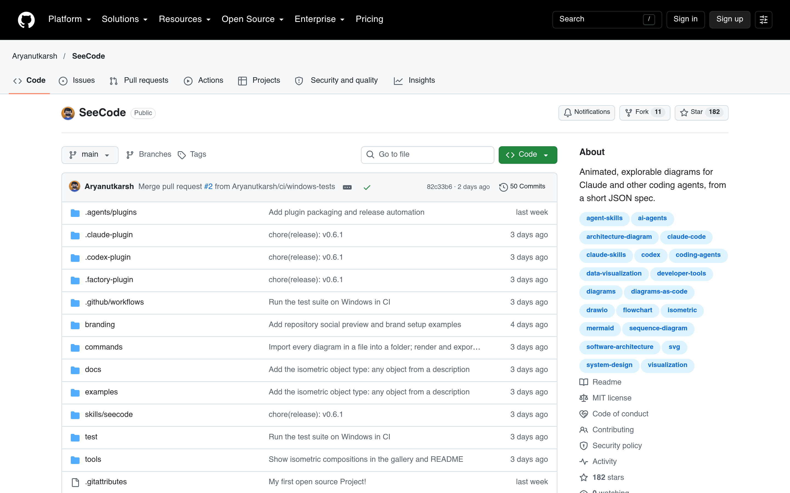

# Agent 动态图表 Skill：SeeCode

## 直观预览

> GitHub 仓库页（1440×900）：Aryanutkarsh/SeeCode，MIT，182 stars，topics：agent-skills / claude-code / codex / diagrams / mermaid。

## 一句话价值

给 coding agent 用的动态图表 Skill：一句话描述需求，生成可交互、可动画的编辑级图表（45 种类型），单文件 HTML 可悬停点击，或导出 SVG/PNG/GIF/MP4——架构图、时序图、甘特图、Wardley 图全覆盖，零依赖、MIT。

## AI 选用指南

| 项目 | 选用说明 |
| --- | --- |
| 优先选用条件 | 需要 Agent 生成架构图/流程图/时序图/数据图表；要可交互（悬停、点击、漫游）或动画演示；要导出进 slides/文档时。 |
| 不适合或暂缓条件 | 静态简单图表用 Mermaid 更轻；v0.6.1 早期版本，复杂图表效果待实测。 |
| 复用方式 | 安装 Skill（`npx skills add Aryanutkarsh/seecode -g`）、直接调用 |
| 输入与产出 | 自然语言描述 / JSON spec / CSV → 可交互 HTML 图表 → 导出 SVG/PNG/GIF/MP4。 |
| 首次读取入口 | [本卡](./Agent动态图表Skill-SeeCode-2026-10-12.md) →「内容摘要」；仓库 https://github.com/Aryanutkarsh/SeeCode。 |
| 同类选择依据 | 库内图表类：[Lieflat Charts](../Skills/单色数据可视化Skill-Lieflat-Charts-2026-07-23.md)（单色静态图表）vs 本 skill（45 种动态可交互图表 + 导出视频）；要动效和交互选 SeeCode，要极简静态选 Lieflat。 |
| 接入前提与待核实项 | MIT；支持 Claude Code / Cursor / Codex / OpenCode；未实际安装测试。 |
| 检索词 | SeeCode 动态图表 Agent Skill diagrams as code 架构图 可视化 |

> 核查记录：整理于 2026-10-12，基于仓库 README 全文 + 仓库元数据（MIT/182 stars/2026-10-02 创建）。未实际安装测试。

## 内容摘要

SeeCode（https://github.com/Aryanutkarsh/SeeCode）是"会动、会讲、会自己导出"的图表工具，定位 Agent Skill。

- **用法**：`npx skills add Aryanutkarsh/seecode -g` 装完直接说人话："Use SeeCode to show how checkout works…"，继续追问 "highlight the payment path"、"make it dark"、"export it for my slides"。
- **45 种图表**：架构图、依赖图、UML、ER、流程图、时序图、状态机、泳道图、数据流、用户旅程、甘特图、看板、Wardley 图、等距视图、柱状/折线/散点等；每种有自己的动画方式，也可全静态。
- **交互**：hover trace、focus panel、route journey——可悬停、可点击、可漫游。
- **导出**：SVG / PNG / GIF / MP4，图表数据走 CSV/JSON（不经过模型）。
- **生态**：skills/seecode/SKILL.md，另有 .claude-plugin / .codex-plugin；零依赖；MIT；v0.6.1。

## 为什么值得收藏

1. **补他的图表能力**：他做走查、述职、方案经常要画架构图/流程图——这个让 Agent 一句话生成，还能导出 GIF/MP4 放演示里。
2. **Agent Skill 形态**：和 hairline、amir-design-judgment 同一类收藏维度，skill 库又添一员"执行型"。
3. **MIT + 零依赖**：商用无忧，装起来没负担。

## 未来可以怎么用

- xiegao2.0 方案文档：让 Agent 用 SeeCode 画系统架构/数据流图。
- 述职/PPT：时序图、甘特图直接导出 GIF 放进 slides。
- bot pipeline：画内容漏斗/流程图。

## 原始内容 / 链接

- 仓库：https://github.com/Aryanutkarsh/SeeCode（MIT，182 stars，2026-10-02 创建）
- 安装：`npx skills add Aryanutkarsh/seecode -g`
- 未实际安装测试。

## 相关联想

- [单色数据可视化 Skill：Lieflat Charts](./单色数据可视化Skill-Lieflat-Charts-2026-07-23.md)：静态极简 vs 动态可交互
- [AI 设计评审 Skill：Amir Design Judgment](./AI设计评审Skill-Amir-Design-Judgment-2026-10-09.md)：一个管"画出来"，一个管"评审"
- [终端风动态架构图生成器：live-panel-skill](../../04-工具网站/开源项目/终端风动态架构图生成器-live-panel-skill-2026-10-05.md)：架构图视频的另一条路线

## 适合反向调用的场景

- 让 AI 画架构图/流程图用什么？
- 有没有能导出 GIF/MP4 的图表工具？
- 45 种图表类型的 Agent Skill？
