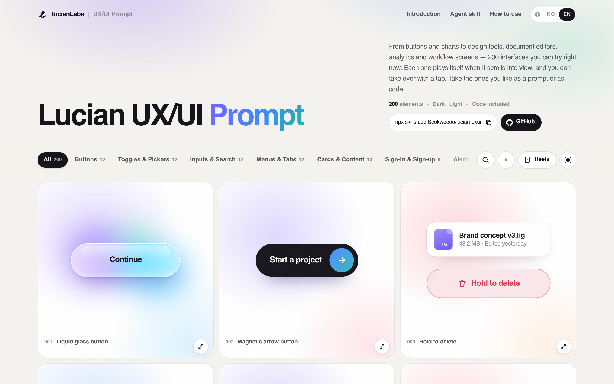
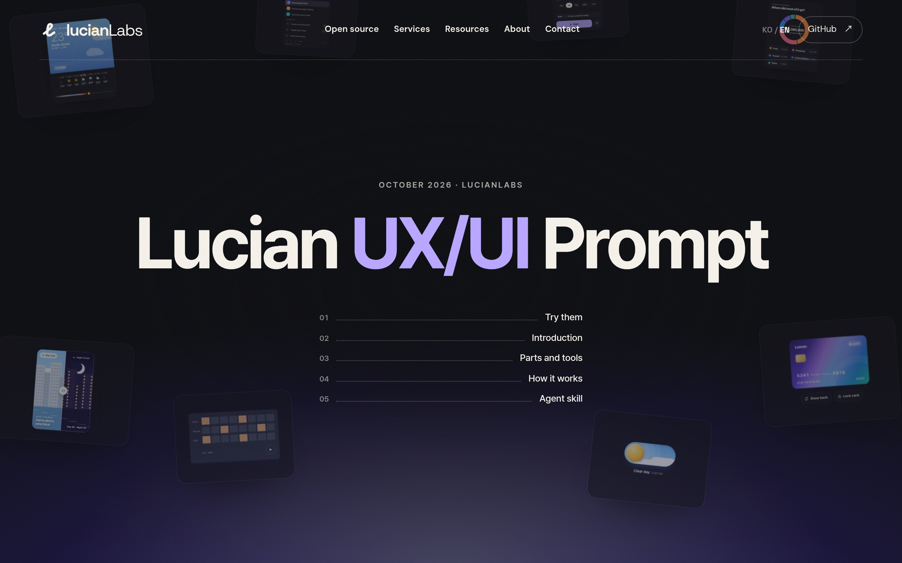

# 可交互 UI 组件库与 Agent Skill：Lucian UX/UI Prompt

## 直观预览

> 上：画廊页（浅色）——200 elements · Dark·Light · Code included，分类标签和 001 液体玻璃按钮 / 002 磁吸箭头按钮 / 003 长按删除。下：介绍页（深色）大标题视觉。

## 一句话价值

200 个真实能跑的 UI 界面（零依赖 HTML/CSS/JS、亮暗双主题、MIT 免费），每个都能一键复制成「完整代码 + 严格移植指令」的 prompt，还有配套 Agent Skill 让 Claude Code / Codex 自己去画廊里挑元素搬进项目——移植规矩写得极死：动效数值原样搬、不许重新猜设计、完工要报告验了什么没验什么。

## AI 选用指南

| 项目 | 选用说明 |
| --- | --- |
| 优先选用条件 | 做页面缺某个构件（按钮/开关/输入/菜单/卡片/登录/通知/加载/空状态/图表/整页工具）时，先来这里找现成可跑的元素再移植；装了 skill 后可直接让 agent 按编号或关键词取元素。 |
| 不适合或暂缓条件 | 元素是独立设计语言，整页照搬会和项目既有风格冲突——按设计铁律，先在 glint-vault 全库找设计语言定调，Lucian 只作构件来源，移植时必须把 --ux-* token 对接到项目主题变量。 |
| 复用方式 | 安装 Skill / 复制 prompt |
| 输入与产出 | 画廊选元素或编号 → 完整可跑代码（按项目框架转写）+ 双主题 token 对接；skill 模式：自然语言描述 → agent 搜索、取元素、移植、报告。 |
| 首次读取入口 | 画廊 https://lucianlabs.dev/uxui-prompt/ ；介绍页 https://lucianlabs.dev/uxui-prompt/introducing/ ；skill 仓库 https://github.com/Seokwoooo/lucian-uxui 。 |
| 同类选择依据 | 与 [SeeCode](./Agent动态图表Skill-SeeCode-2026-10-12.md)：SeeCode 专做动态图表，Lucian 是通用 UI 部件 + 整工具；与 [Lieflat Charts](./单色数据可视化Skill-Lieflat-Charts-2026-07-23.md)：静态极简图表 vs 可交互通用组件；与 *cn 家族：registry 装 React 组件 vs 框架无关的 prompt 移植。 |
| 接入前提与待核实项 | skill 需 Node 18+（无 Node 时 agent 用 curl 兜底）并能访问 lucianlabs.dev；仓库 2026-10-12 刚建、3 星，尚未实际安装测试；元素英/韩双语（默认英文）。 |
| 检索词 | lucian uxui prompt lucian-uxui UI 组件库 agent skill 移植 |

> 核查记录：整理于 2026-10-13，基于介绍页全文（韩文）、画廊页实拍、skill 仓库 README 与 GitHub 元数据。未实际安装测试。

## 内容摘要

- **规模**：200 个界面、14 个分类，全部是真实可运行代码（不是效果图），零外部依赖，亮/暗双主题，MIT 免费（代码顶部保留一行出处）。
  - **001–100 基础部件**：按钮、开关·选择、输入·搜索、菜单·标签、卡片·内容、登录·注册、通知·反馈、加载·进度、空·错误状态、小部件·图表。
  - **101–200 整工具**：平面图与日程、文档·数据编辑器、分析图表、业务系统（如节奏音序器），拿来即是一个完整功能。
- **核心机制——「复制 prompt」**：每个元素点一下，复制的是完整代码 + 一套移植指令（以 005 纸飞机发送按钮为例）：先查项目框架/样式方式/主题方式并定位插入点；保留原有数据、props、事件和无障碍属性；结构与动效数值（时长、曲线、延迟）原样搬，**明确写了不许重新猜设计**；颜色把 `--ux-*` token 对接到项目主题变量、双主题都验；样式只关在元素自己的类里不动全局；检查 prefers-reduced-motion；完工报告改了哪些文件、行为差异、验过的范围（双主题/移动宽度/键盘）和没验的项。
- **Agent Skill（lucian-uxui）**：`npx skills add Seokwoooo/lucian-uxui`，或 Claude Code 插件（marketplace add + install）。skill 本体 = SKILL.md + 移植指南 + 零依赖 CLI（search / list / get / tokens），数据从 lucianlabs.dev 的静态 API 拉（GitHub 有镜像仓库 lucian-uxui-prompt），**新元素上线不用更新 skill**。用法三种：说人话让它配（如「加个定价开关和 FAQ」）、给编号（#056）、直接调用 `/lucian-uxui`（Codex 里是 `$lucian-uxui`）。
- **作者与状态**：lucianLabs，韩国开发者 Seokwoooo；2026 年 10 月发布，skill 仓库 2026-10-12 建仓，MIT，尚属非常早期。

## 为什么值得收藏

1. **理念和设计铁律同频**：「不许重新猜设计、动效数值原样搬、完工报告验了什么/没验什么」——正是「临摹 > 发明」和真实走查验收的规矩，这个库把规矩直接写进了每个元素的 prompt 里。
2. **构件是真能跑的**：画廊里每个元素滚到眼前会自己演示、可以上手点；不是 Dribbble 式的效果图，搬下来就能用。
3. **101–200 是整工具不是部件**：平面图、日程、数据编辑器这类整功能也能一键移植，省的是大块时间。
4. **分发方式值得学**：元素数据走静态 API + skill 只当薄壳，新元素不用更新 skill——给自己的收藏库做 agent 分发时可借鉴（见创意线索）。

## 未来可以怎么用

- stockmon、bot 素材库、wuyu.uk 等页面缺构件时，先来这里按分类/编号找，再按移植指令搬。
- 先小规模实测：挑 1–2 个元素装 skill 搬进一个测试页，验双主题和动效数值是否真原样。
- 自查清单来源：移植指令里的「完工报告」格式可直接借来当页面交付的验收模板。

## 原始内容 / 链接

- 介绍：https://lucianlabs.dev/uxui-prompt/introducing/
- 画廊：https://lucianlabs.dev/uxui-prompt/
- Skill 仓库：https://github.com/Seokwoooo/lucian-uxui ；数据镜像：https://github.com/Seokwoooo/lucian-uxui-prompt

## 相关联想

- [Agent 动态图表 Skill：SeeCode](./Agent动态图表Skill-SeeCode-2026-10-12.md)：专做动态图表的 skill
- [单色数据可视化 Skill：Lieflat Charts](./单色数据可视化Skill-Lieflat-Charts-2026-07-23.md)：静态极简图表
- [流体功能主义组件库：Fluid Functionalism](../01-界面设计/动效/流体功能主义组件库-Fluid-Functionalism-2026-10-09.md)：同样带 skill 的动效规范+组件

## 适合反向调用的场景

- 有没有现成能跑的 UI 组件库可以让 agent 自己挑着搬？
- 做页面缺某个交互构件/整工具，去哪找？
- 「代码 + 移植 SOP」打包成 prompt 的做法哪张卡有？
