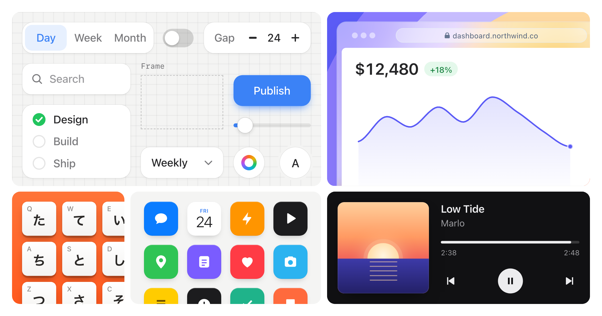

# 假产品界面演示 Skill：Stageshow

## 直观预览

> Stageshow 仓库官方预览图（`.github/assets/stageshow.png`，2400×1260，2026-11-02 取）：微型产品界面被裁切、装框成营销页演示画面的效果示意。本卡为 Skill 说明，未在本机安装运行。

## 一句话价值

一个教 coding agent 做"假产品界面"的 Skill：把产品 UI 按营销页的规矩简化、装框、裁切成演示静图或带光标的短动画——核心手艺不是画界面，而是"简化文字、不简化语境"和一套拍片式的自检流程；它与 Fluid Functionalism 的分工，正是这条帖子的题眼：Stageshow 做演示用的假界面，真产品去 slop 要用真组件。

## AI 选用指南

| 项目 | 选用说明 |
| --- | --- |
| 优先选用条件 | 给落地页/官网做产品演示图、功能卡、bento 网格、hero 演示动画；产品还没上线或功能没做完，需要先有可信的产品画面；已有真实产品时，把它自己的 token、图标、文案喂给 skill，让假界面长得像真产品。 |
| 不适合或暂缓条件 | 做真产品界面本身——那是 [Fluid Functionalism 组件库](../../01-界面设计/动效/流体功能主义组件库-Fluid-Functionalism-2026-10-09.md)的活，本卡只做"演示画面"；需要真实截图证明功能时（如应用商店审核、客户验收）不许用假界面冒充。 |
| 复用方式 | 安装 Skill（`npx skills add benjitaylor/skills --skill stageshow`）；套用其工作流（先写计划→选 gold 范例→套 kit 搭建→film 拍片自检→rehearsal 交付说明）；其反 slop 规则可单独当演示图评审清单用。 |
| 输入与产出 | 输入：产品简报（要演示的功能、风格、尺寸）+ 可选的真实产品代码/站点（提取 token 与图标）→ 产出：React + CSS 的微型界面，静图或 10–16 秒循环动画，附 REHEARSAL.md 交接说明。 |
| 首次读取入口 | 仓库 `stageshow/SKILL.md`（149 行）先读 "The one idea" 与 Workflow；动手前按其规则先 film 一遍最接近的 gold 范例（examples/ 目录），再读 `references/craft.md`。 |
| 同类选择依据 | 与 [Fluid Functionalism](../../01-界面设计/动效/流体功能主义组件库-Fluid-Functionalism-2026-10-09.md)：一假一真——营销演示选本卡，真产品界面选 FF（或先用 FF 的 primitives 搭真界面，再截取/改造成演示）；与 [Recordly](../../04-工具网站/开源项目/开源演示视频录屏编辑器-Recordly-2026-07-09.md)：Recordly 录真软件的操作，本卡造不存在或未完成的界面；与 [Lucian UX/UI Prompt](./UI组件库与Agent-Skill-Lucian-UXUI-Prompt-2026-10-13.md)：Lucian 给真实可跑的 UI 元素库，本卡给演示画面的构图与拍摄规矩。 |
| 接入前提与待核实项 | MIT（仓库 stageshow/LICENSE，© 2026 Benji Taylor）；仓库 benjitaylor/skills 约 548 星（2026-11-02），最近推送 2026-10-31；技术栈 React + 纯 CSS，需要 Node 跑 film 脚本；未在本机安装实测。注意伦理边界：假界面只用于演示与营销语境，不能冒充真实功能证据。 |
| 检索词 | Stageshow、假产品界面、faux UI、产品演示图、营销演示、bento 网格、hero demo、cursor walkthrough、unslopify、benjitaylor skills、fake product UI skill |

> 核查记录：2026-11-02 经公开接口读 X 原帖与被引帖全文；读仓库 stageshow/SKILL.md 全文（149 行）与 LICENSE；星数与推送时间为当日 GitHub API 值。收藏不证明已安装、已运行或已获授权。

## 内容摘要

### 这条帖子到底在说什么

2026-11-02，Benji Taylor（@benjitaylor）发布 Stageshow：一句话介绍是"帮你的 agent 做更好的假 UI 静图、动画、bento 网格的 skill"，安装命令 `npx skills add benjitaylor/skills --skill stageshow`。

Airbnb 的产品设计工程师 Micka（@micka_design，Fluid Functionalism 作者）引用转发，给它划了边界（大意）：**这个 skill 是给营销演示做假产品 UI 的；想给你的真产品"去 slop"，第一步先用对 primitives——Fluid Functionalism（shadcn 底座、开源），第二步用他的 skill 把规范接到产品上**（`npx skills add mickadesign/fluid-functionalism`）。

所以这条帖子的信息量不在 Stageshow 本身，而在一个分工判断：**"假界面演示"和"真产品界面"是两件不同的活，用两套工具**——演示画面追求可信与构图，产品界面追求真实组件与规范。把这条判断单独立卡，是因为它能防止以后选型时混用。

### Stageshow 的手艺（读 SKILL.md 后的提炼）

- **一句话原则**：读起来像真产品，简化到观众需要看懂的程度，装框有意图，每个动效都有因果。原话概括为 "simplify the words, not the context"——简化文字，不简化语境。
- **五种死法**（它给假界面定的失败模式）：太满（每行都是真文字、数字堆满，反而像 AI 生成的）；线框感（只剩灰块和按钮）；装箱感（整个窗口等距缩进卡片，像截图粘贴而不是产品照）；扁平（所有元素同权重，眼睛无处落）；平庸（无视简报风格的灰窗加光标）。
- **文字预算**：一屏真实字符串通常只留 3–7 个，其余用占位条；真实文字只出现在故事所在的位置——这是它反"AI 味"的核心手法：满屏真字恰恰是最假的。
- **构图规矩**：窗口至少占舞台三分之二并出血到边缘；不许窗口四边悬空、不许底下垫"盘子"；只让填充内容出血，打开的东西必须留在画面内；按最终展示尺寸设计（hero 约 720×340、卡片 400×300、手机列要有 358 宽的 compact 重新设计而不是压缩）。
- **拍片式流程**：先写计划（位置、焦点物、动作、回报、能删什么）→ 从约 30 个 gold 范例里选最接近的，先用 film 脚本把它拍出来当标尺 → 复制范例改造成目标产品（只换名字不算完）→ 编排 3–5 个节拍、10–16 秒的故事 → 先定 poster 帧（多数人只看到这一帧）→ film 全片逐帧检查、修最大可见错误 → 交付时附 REHEARSAL.md（抄了哪个范例、改了什么、什么没验）。
- **明确的反 slop 清单**：不许用 AI 星光（sparkles）、紫色、彩色方块里放字母这类"假 logo"；状态栏和 home indicator 不许手画（Phone 组件自带）；数据不许无因果地倒带；选区必须落在 I 型光标下，等等。
- **家底**：examples 分三档——gold（质量标尺）、product studies（Figma/Linear/Slack 等真产品，只借交互不借身份）、teaching（好坏对照对，坏的一半永远不许当起点）。

### 与 Fluid Functionalism 的关系（帖子的另一半）

- FF 是真产品路线：shadcn 底座的 28 个动效组件 + 设计系统 + agent skill，库内已有卡（2026-10-09），本轮已给旧卡补记这条帖子与新的安装命令，星数从 1010 涨到 1110（2026-11-02）。
- 两条路线可以接力：用 FF 的规范搭真产品 → 演示时用 Stageshow 的规矩把真界面简化装框。Micka 本人就是 FF 作者，他的转发等于官方盖章这个分工。

## 为什么值得收藏

- 它是"agent 做视觉"类 skill 里少见的把**审美判断写成可执行规则**的样本：失败模式、文字预算、构图比例、自检顺序全是硬规则，和 Amir Design Judgment 的评审型 skill、Lucian 的移植型 skill 凑成三种不同的"设计知识装进 skill"的方法。
- 对用户的直接用途明确：stockmon、xiegao2.0 以后做落地页和功能演示，不必等产品做完、不必录屏凑数，可以直接按这套规矩出演示图与动画。
- 帖子的分工判断（假演示 vs 真产品）本身值得存：它给库里所有 UI 类收藏加了一条分流线。

## 未来可以怎么用

- stockmon 落地页重做时：hero 区用 Stageshow 做一张"库存命中提醒"的演示画面（用产品自己的配色与真实文案，只留 3–7 个真实字符串），比截图缩小粘贴专业一个档次。
- xiegao2.0 产品化对外页：未上线的功能先用假界面讲清楚故事，上线后换真截图，构图规矩不变。
- 把它的"五种死法 + 反 slop 清单"抽出来当通用评审清单：任何 AI 生成的演示图、汇报配图先过一遍这张单子。
- 与 FF 接力试验：挑一个小页面先用 FF skill 搭真界面，再用 Stageshow 把它改成演示卡，验证两套 skill 的衔接成本。

## 原始内容 / 链接

- Micka 的帖子（2026-11-02 10:23 CST 发布，查阅时约 6.8k 浏览 / 98 赞 / 228 收藏）：https://x.com/micka_design/status/2117080232658419970 —— 原文大意：这个 skill 是给营销演示做假产品 UI 的；想给真产品 unslopify：① 先用对 primitives：fluidfunctionalism.com（shadcn 底座，开源）；② 用这个 skill 补上差距：`npx skills add mickadesign/fluid-functionalism`。
- 被引原帖（Benji Taylor）：https://x.com/benjitaylor/status/2116593247854453244 —— Stageshow 发布帖，安装命令 `npx skills add benjitaylor/skills --skill stageshow`。
- Stageshow 仓库：https://github.com/benjitaylor/skills （skill 在 `stageshow/` 目录，SKILL.md 149 行，MIT）
- Fluid Functionalism：https://www.fluidfunctionalism.com ；仓库 https://github.com/mickadesign/fluid-functionalism

## 相关联想

- [流体功能主义组件库：Fluid Functionalism](../../01-界面设计/动效/流体功能主义组件库-Fluid-Functionalism-2026-10-09.md)：本帖的另一半，真产品路线；两卡互为分工对照，选型时先判断"做演示还是做产品"。
- [AI 设计评审 Skill：Amir Design Judgment](./AI设计评审Skill-Amir-Design-Judgment-2026-10-09.md)：评审型 skill；Stageshow 是生产型 skill，但自带 rehearsal 自检，等于把评审环节内嵌进了生产流程——值得对比两种装法。
- [可交互 UI 组件库与 Agent Skill：Lucian UX/UI Prompt](./UI组件库与Agent-Skill-Lucian-UXUI-Prompt-2026-10-13.md)：Lucian 的范例是可跑的真界面，Stageshow 的 gold 范例是演示构图标尺；一个供"搬进产品"，一个供"对标画面"。
- [开源演示视频录屏编辑器：Recordly](../../04-工具网站/开源项目/开源演示视频录屏编辑器-Recordly-2026-07-09.md)：真录屏路线，与假界面路线互补：功能已稳定用录屏，功能未成型用 Stageshow。

## 适合反向调用的场景

- 我最近收藏了哪些相关内容？
- 这个项目可以借用什么素材？
- 有没有类似表达、结构、做法可以复用？
- 做落地页/营销页的产品演示图与动画时，先读本卡，再决定演示用假界面还是真截图。
- 给 AI 生成的界面图挑毛病时，调本卡"五种死法"清单逐项对照。
