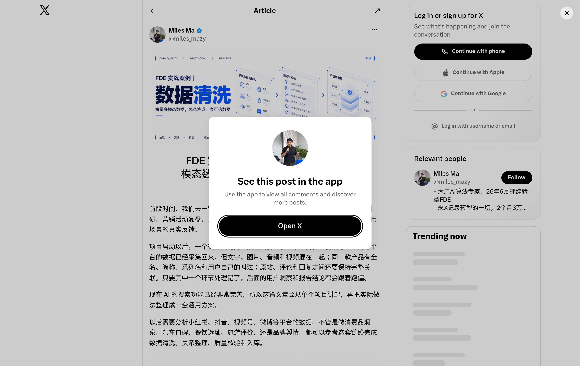

# FDE 实战案例：多模态数据清洗八步链路

## 直观预览

> 长文封面：多模态数据输入 → 清洗与校验 → 可信数据集；作者 Miles Ma（大厂 AI 算法背景，2026 年 6 月裸辞转型 FDE）。24.4 万浏览、3499 书签（2026-10-29 查）。

## 一句话价值

一篇把「海量社媒多模态数据怎么洗成可信数据」讲成完整工程链路的实战长文：八步流程的核心纪律是原文只增不改、冲突按 A–E 证据等级处理、风险分只许排序不许自动删除——和温暖瞬间bot、xiegao2.0 的数据原则几乎逐条对应，且给出了可直接借用的分级框架。

## AI 选用指南

| 项目 | 选用说明 |
| --- | --- |
| 优先选用条件 | 设计或改造任何「多平台内容抓取 → 清洗 → 打分/结构化 → 人工终审」链路时，先读这张卡的八步与证据分级，再对照自己 pipeline 缺哪一环。 |
| 不适合或暂缓条件 | 案例是美妆舆情场景，字段设计（功效/肤感/成分）不可直接搬；借的是链路结构与纪律，不是字段表。 |
| 复用方式 | 链接收藏 |
| 输入与产出 | 长文方法论 → pipeline 检查清单（原文保留/关系建模/证据分级/四种输出状态/版本与回归样本）。 |
| 首次读取入口 | 原帖 https://x.com/miles_mazy/status/2115006510979801566（X 长文，需在 X 内阅读）。 |
| 同类选择依据 | 与 xiegao2.0 的 Evidence/VOICES 设计（项目内文档）：那边是自家规则，这篇是外部实战版，可互相对照查漏；与 [Unlimited-OCR](../04-工具网站/开源项目/文档解析开源模型-Unlimited-OCR-2026-10-12.md)：那边是单点工具（文档转文本），这篇是整条链路。 |
| 接入前提与待核实项 | 单一作者的项目复盘，未见公开代码与数据字典实物；互动数据为 2026-10-29 查得，会继续变。 |
| 检索词 | FDE 数据清洗 多模态 舆情 miles_mazy 证据等级 原文保留 |

> 核查记录：整理于 2026-10-29，基于未登录状态下完整阅读的长文全文。本卡只做摘要与结构提炼，不转录原文。

## 内容摘要

- **案例背景**：作者给一家美妆企业做 FDE 落地，业务是舆情分析、竞品调研、营销复盘和评论区反馈提取；数据来自小红书、抖音、视频号、微博，文字/图片/音频/视频混杂，同一产品叫法不一，原帖—评论—回复关系必须完整保留。
- **八步链路**：①先按最终用途定数据规范（必填字段、关联关系、去重口径因用途而异，不在采集后直接删）→ ②保留原始内容（原文、原图、原音视频、链接、时间、平台原始 ID 全留；OCR/ASR/模型标签只能新增、不能覆盖）→ ③梳理数据关系（平台内用 user/post/comment/parent 四类 ID，「平台名+原始 ID」作主键；跨平台不凭昵称头像认人，只汇总话题与对象）→ ④多模态归一（四种模态分别处理，统一成「谁在何时说了什么、提到什么对象、证据在原内容何处」；工具组合：FFmpeg、PaddleOCR、Whisper 本地优先，云端 OCR/ASR 补充，并建轻量工作台记录调用量、耗时、费用、失败原因）→ ⑤冲突和质量清洗（证据分五级：A 官方/人工确认、B 原内容可直接确认、C 多模型一致且上下文吻合、D 单模型结果、E 关键词/规则候选；能确认的修正要同时保留原值、修正值、等级、原因、复核状态、模型版本，不能确认的进待核队列且不参加精确统计）→ ⑥筛选、重复归组、异常识别分开做，输出四种状态：正常可用 / 重复关联 / 低质量待修复或隔离 / 高风险人工复核（风险分只用于排序，统一素材和矩阵账号本就高度相似，不许见高分就删）→ ⑦生成结构化数据（观点拆为表达者与对象、提及的产品/部件/功能、对象间关系、观点/意图、判断依据原文位置；规则和小模型干高频稳定任务，大模型干多语种与复杂指代，低置信进人工复核，输出固定 JSON 字段与证据格式）→ ⑧验收与入库（完整性、回溯性、位置标注、冲突状态、标签绑定、版本号逐项核查；用人工确认的正常样本+难例样本做回归；原始数据、处理结果、质量状态、版本信息分开存）。
- **交付物清单**：数据字典、关系说明、处理流程、质量报告、难例集、复核队列、版本记录。

## 为什么值得收藏

1. **「原文只增不改」是全链路的地基**：派生结果（OCR/ASR/标签/修正）全部以新增字段存在、带证据位置和版本——这正是 xiegao2.0 里 VOICES「只能引述不能当事实」、bot「原作者没解释的细节不许脑补」的工程化写法，这篇给了完整实现细节（待核队列、回归样本集）。
2. **A–E 证据分级可直接借用**：比 xiegao Research 现行的「已核验/待核验/风险」三档更细，尤其 C 级「多模型一致且上下文吻合」和 E 级「规则候选」补上了中间地带。
3. **人机分工的立场一致**：风险分只排序不删除、低置信一律进人工复核队列——和 bot「机器初筛、用户终审」同一套哲学，但这篇把队列和状态机写全了（四种输出状态）。

## 未来可以怎么用

- bot pipeline 下次改版时对照八步查漏：重点看素材的「质量状态」是否与原文、处理结果分开存，难例集有没有沉淀下来做回归。
- xiegao2.0 的 corroboration 环节考虑引入 A–E 分级替换三档标注。
- 新接任何社媒数据类项目（如客户的热点抓取），用交付物清单当报价与验收的骨架。

## 原始内容 / 链接

- 原帖：https://x.com/miles_mazy/status/2115006510979801566（2026-10-27 发布，X 长文）
- 作者：Miles Ma（@miles_mazy），自述大厂 AI 算法专家，2026 年 6 月裸辞转型 FDE，做 AI 算法研发、企业 AI 培训与 FDE 落地交付。

## 相关联想

- [文档解析开源模型：Unlimited-OCR（百度）](../04-工具网站/开源项目/文档解析开源模型-Unlimited-OCR-2026-10-12.md)：链路中「文档/图片转文本」一环的工具选项
- [可交互 UI 组件库与 Agent Skill：Lucian UX/UI Prompt](./UI组件库与Agent-Skill-Lucian-UXUI-Prompt-2026-10-13.md)：同为「规矩写进流程」的思路，一篇讲数据、一篇讲 UI 移植

## 适合反向调用的场景

- 多平台抓来的数据怎么清洗才可信？
- 证据分级 A–E 是哪张卡？
- 素材 pipeline 的验收和回归样本怎么做？
