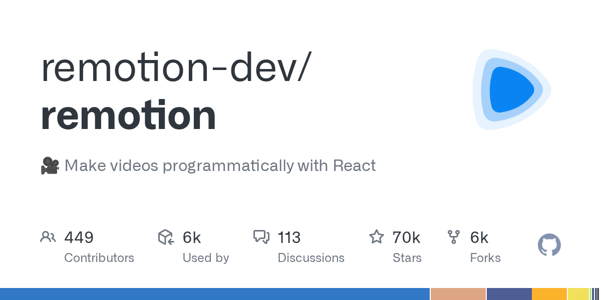
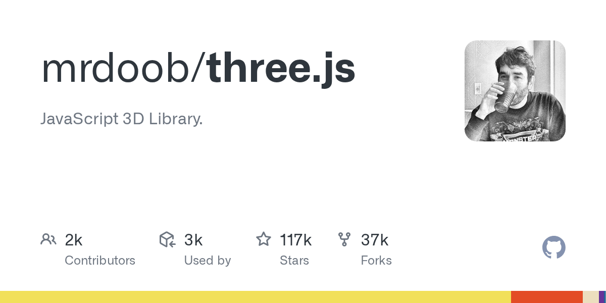

# 开源动作工作室工具链：22 个库拼出代码化视频管线

## 直观预览

> 管线主干 Remotion 的 GitHub 官方社交预览图（2026-11-02 取）：用 React 写视频、逐帧渲染成片。

> 3D 层代表 Three.js 的 GitHub 官方社交预览图（2026-11-02 取）。本卡是工具链清单，没有单一产品界面；两张图均为仓库官方预览图，不是运行截图，整栈未安装、未实测。

## 一句话价值

一条在社交平台流传的清单：把 After Effects 式的一体化动作工作室拆成 22 个开源库的五层代码管线——Remotion 主干渲染、动画/3D/物理三层生产、声音与后期交付；真正的卖点不是"免费"，而是"一切皆代码"：可批量、可版本管理、可被 AI agent 编排。

## AI 选用指南

| 项目 | 选用说明 |
| --- | --- |
| 优先选用条件 | 要批量生成结构相同的视频（数据驱动、模板化日更、稿件转竖版视频）；产物是成片文件（mp4）而非网页内动画；能接受用 React/代码写镜头、让 AI 写胶水代码。先只取最小子集：Remotion + Anime.js + FFmpeg，跑通一条再扩层。 |
| 不适合或暂缓条件 | 一次性精修、客户逐帧改稿、套现成 AE 模板——这类活 AE 的时间轴 GUI 仍更快；没有代码维护能力时，22 个库等于 22 套 API 和维护风险，不要整栈全上。物理层（Taichi / SPlisHSPlasH）是研究级工具，集成成本最高，没有明确模拟需求时暂缓。 |
| 复用方式 | 安装依赖（按层取单个库）；套用管线分层法（主干渲染→生产层→声音→后期交付）规划自己的视频生产流程；单个库的官方文档与仓库即首次读取入口。 |
| 输入与产出 | 输入：文案/数据/素材（图片、音频、3D 场景）+ React 代码描述镜头 → 产出：逐帧渲染的 mp4 成片；中间层可单独产出动画片段、3D 镜头、模拟结果、配音与字幕文件。 |
| 首次读取入口 | 本卡「内容摘要」的五层表先定位层级；主干先读 Remotion 仓库 README 与其 LICENSE.md（许可与众不同，见接入前提）；3D 先读 Three.js 仓库；其余按表内链接进各仓库。 |
| 同类选择依据 | 与[终端风动态架构图生成器：live-panel-skill](./终端风动态架构图生成器-live-panel-skill-2026-10-05.md)分工：live-panel 是一个 JSON 配置生成终端风动态图的专用机，本栈是 React 通用管线、能做任意题材；与[网页动画库：Motion](../../01-界面设计/动效/网页动画库-Motion-2026-08-22.md)分工：Motion 是网页内实时动画，本栈的目标是渲染成视频文件；与[AI 提示词视频编辑器：ChatCut](../在线工具/AI提示词视频编辑器-ChatCut-2026-07-12.md)分工：ChatCut 是托管服务开箱剪辑，本栈是自建管线、批量与可编程优先。 |
| 接入前提与待核实项 | **许可红线**：Remotion 不是 OSI 开源许可——个人、员工 ≤3 人的营利组织、非营利可免费商用，超过规模的营利组织须付 Company License（其仓库 LICENSE.md 原文，2026-11-02 核）；用户所在 MCN 公司规模明显超过 3 人，公司业务商用前必须先核 Remotion 许可，不能按"免费"立项。FFmpeg 为 LGPL/GPL 组合，分发时注意构建选项。其余 20 个为 MIT/Apache/ISC/Unlicense/GPL/BSD 式等宽松或 copyleft 许可（见内容摘要表）。整栈未安装未实测；帖子所称搭配的模型名"Opus 5.5"未核实，只按"AI 写代码编排"理解，不当事实。 |
| 检索词 | 开源动作工作室、替代 After Effects、代码生成视频、程序化视频、Remotion、Anime.js、Theatre.js、Three.js、Babylon.js、Drei、Gaussian Splatting、Taichi 物理模拟、Qwen3-TTS、Auto-Editor、RIFE 补帧、motion graphics open source stack、programmatic video pipeline |

> 核查记录：2026-11-02 用 GitHub API 逐个核验全部 22 个仓库的存在、许可证（SPDX）、星数与最近推送时间；Remotion 许可另读其仓库 LICENSE.md 原文。星数为核验当日近似值。收藏不证明已安装、已运行或已获授权。

## 内容摘要

### 先纠正帖子的三句话

1. **"100% 免费"不成立**：22 个里 21 个是真开源（MIT/Apache 为主），唯独主干 Remotion 是自定义许可——个人和小团队（营利组织 ≤3 名员工）免费，规模以上的营利组织要买 Company License。对个人自用没影响，对公司业务是真金白银的立项前提。
2. **"再也不用 After Effects"只对一半活成立**：这套栈没有时间轴 GUI、没有统一工程格式，赢的是批量、数据驱动、模板化、可编程；输的是单条精修、临时改稿、设计师手感活。它替代的是 AE 的"渲染农场+模板套改"那部分，不是全部。
3. **"只要 AI + 这些库就行"的前提是 AI 写胶水代码**：22 个库是 22 套 API，人手工编排不现实；这条清单成立的隐含条件，就是让编码模型把各层粘起来——所以它本质是一份"给 AI 的工具箱清单"，不是给人逐个学的软件列表。

### 五层拆解（星数与许可为 2026-11-02 GitHub 核验值）

**第 0 层 · 主干：把代码渲染成视频**

| 库 | 定位 | 许可 | 星数 |
| --- | --- | --- | --- |
| [Remotion](https://github.com/remotion-dev/remotion) | React 视频引擎：用组件写镜头，逐帧渲染出 mp4，整条管线的总装线 | 自定义（见上） | 约 69.7k |

**第 1 层 · 2D 动画与图形**

| 库 | 定位 | 许可 | 星数 |
| --- | --- | --- | --- |
| [Anime.js](https://github.com/juliangarnier/anime) | 时间线编舞：补间、交错、SVG 动画的主力 | MIT | 约 74.2k |
| [mo.js](https://github.com/mojs/mojs) | 形状爆发（burst）与运动图形，经典老库，与 Anime.js 部分重叠，新项目优先 Anime.js | MIT | 约 18.8k |
| [Theatre.js](https://github.com/theatre-js/theatre) | 可视化关键帧编辑器：给代码动画补一个"能拖的时间轴"，也可驱动 Three.js 对象；最近推送停在 2024-08，更新明显放缓，选型注意 | Apache-2.0 | 约 12.8k |
| [Two.js](https://github.com/jonobr1/two.js) | 二维矢量场景（SVG/Canvas/WebGL 三渲染器） | MIT | 约 8.7k |
| [D3](https://github.com/d3/d3) | 数据驱动图形：数据故事、动态图表镜头的数据层 | ISC | 约 113.8k |

**第 2 层 · 3D**

| 库 | 定位 | 许可 | 星数 |
| --- | --- | --- | --- |
| [Three.js](https://github.com/mrdoob/three.js) | WebGL 3D 场景与相机，本层地基 | MIT | 约 117.4k |
| [Babylon.js](https://github.com/BabylonJS/Babylon.js) | 实时 3D 引擎：比 Three.js 更"全家桶"，与 Three.js 是二选一关系，不是叠加 | Apache-2.0 | 约 26.3k |
| [Drei](https://github.com/pmndrs/drei) | React Three Fiber 的现成助手组件库，用 React 方式搭 3D 镜头时才需要 | MIT | 约 10.1k |
| [Spark](https://github.com/sparkjsdev/spark) | 高斯泼溅（3D Gaussian Splatting）渲染器 for Three.js：把实拍重建的 3D 场景塞进网页/视频管线，是这层的新变量 | MIT | 约 3.8k |
| [cables.gl](https://github.com/cables-gl/cables_electron) | 节点式视觉编程（类 VVVV/TouchDesigner 思路）：不写代码连节点做视觉场景；所链仓库只是桌面壳（约 122 星），本体是在线平台 cables.gl | MIT | — |
| [THREE-CustomShaderMaterial](https://github.com/FarazzShaikh/THREE-CustomShaderMaterial) | 在 Three.js 光照模型上写自定义着色器，做风格化材质 | MIT | 约 1.4k |

**第 3 层 · 物理模拟（成本最高的一层）**

| 库 | 定位 | 许可 | 星数 |
| --- | --- | --- | --- |
| [Taichi](https://github.com/taichi-dev/taichi) | Python 写 GPU 并行计算与物理模拟（布料、粒子、刚体），产出序列再回灌渲染层 | Apache-2.0 | 约 28.4k |
| [SPlisHSPlasH](https://github.com/InteractiveComputerGraphics/SPlisHSPlasH) | SPH 流体模拟（水花、泡沫），学术级 C++ 工具，面向研究而非开箱生产 | MIT | 约 1.9k |

**第 4 层 · 手绘动画**

| 库 | 定位 | 许可 | 星数 |
| --- | --- | --- | --- |
| [OpenToonz](https://github.com/opentoonz/opentoonz) | 二维手绘角色动画软件，源自吉卜力使用过的 Toonz，由 DWANGO 开源；是这份清单里唯一真正的"软件本体"，其余多为库 | BSD 式自定义 | 约 7.9k |

**第 5 层 · 声音、字幕与后期交付**

| 库 | 定位 | 许可 | 星数 |
| --- | --- | --- | --- |
| [Qwen3-TTS](https://github.com/QwenLM/Qwen3-TTS) | 阿里通义的开源 TTS 系列：表现力配音、声音设计与克隆、流式生成 | Apache-2.0 | 约 14.1k |
| [Audacity](https://github.com/audacity/audacity) | 音频清理与混音的老牌编辑器 | GPL 系 | 约 18.9k |
| [Subtitle Edit](https://github.com/SubtitleEdit/subtitleedit) | 字幕编辑与时间轴对齐 | MIT | 约 14.8k |
| [Auto-Editor](https://github.com/WyattBlue/auto-editor) | 按静音自动粗剪：砍掉无声段落，口播类素材的第一道剪 | Unlicense | 约 5.7k |
| [RIFE](https://github.com/hzwer/ECCV2022-RIFE) | 帧插值：补帧、慢动作（ECCV 2022 论文实现） | MIT | 约 5.6k |
| [OBS Studio](https://github.com/obsproject/obs-studio) | 屏幕/画面捕捉，录制管线的入口 | GPL-2.0 | 约 78.8k |
| [FFmpeg](https://github.com/FFmpeg/FFmpeg) | 编码、转码、合成与最终交付，全管线的下水道与出厂口 | LGPL/GPL 组合 | 约 66.2k |

### 结构判断

- 真正决定成败的只有主干：Remotion 把上面所有层的产出（DOM 动画、Canvas、WebGL 画面）统一成"某一帧的画面"，再逐帧落成视频。没有主干，这就是 21 个互不相干的库。
- 层与层之间没有现成接口：3D 渲染进 Remotion 要走帧捕获，物理模拟结果要导成序列帧或网格再回灌——胶水代码量随层数指数上升，这正是帖子默认让 AI 干的活。
- 维护风险不均：Three.js/D3/FFmpeg/OBS 是十年以上的地基型项目；Theatre.js 更新放缓、SPlisHSPlasH 偏学术、Spark 很新——选型时按"地基可以压重注、边缘层随时可替换"处理。

## 为什么值得收藏

- 这是目前流传最完整的一份"代码化动作工作室"选型清单，且 22 个仓库经逐个核验全部真实存在、许可与活跃度已摸清，纠正了原帖"100% 免费"的关键误导（Remotion 的公司规模红线）。
- 它给"AI 做视频"提供了一个具体的工程形状：不是生成模型一把梭，而是"AI 编排确定性的库"——产出可复现、可批量、风格可控，正好补生成式视频不可控的短板。
- 分层结构本身可复用：以后评估任何视频工具链，都可以按主干/生产/模拟/声音/交付五层定位它缺哪层、和已有工具怎么拼。

## 未来可以怎么用

- **xiegao2.0 / 抖音新业务**：给稿件加一条"成片"的腿——最小管线先行：Remotion 竖版模板（标题、口播字幕条、素材位）+ Qwen3-TTS 配音 + Subtitle Edit 字幕 + Auto-Editor 粗剪，一条抖音跑通后再谈 3D 与物理层。注意：若以公司名义规模化使用 Remotion，先核 Company License。
- **温暖瞬间bot**：已拍板的图文素材批量渲染成竖版视频，分发抖音/视频号；bot 的文案红线不变（只写原文确定内容、不脑补），视频层只做排版与动效，不新增信息。
- **数据故事视频**：D3（或库内 SeeCode 的图表思路）出动态图表镜头，Remotion 合成，替代手工录屏讲数据。
- **个人试验田**：先在个人项目里用免费档跑 Remotion + Three.js/Drei 做一个 3D 镜头样片，验证 AI 编排这套栈的真实工时，再决定是否投入管线化。

## 原始内容 / 链接

用户于 2026-11-02 转述的清单原文要点：标题宣称"100% 免费的 22 个开源库就能搞定动作工作室，不再用 After Effects，只要（AI 模型）+ 这 22 个 GitHub 工具：动画、物理、3D、渲染、交付"。22 个链接如下（与本卡内容摘要的五层表一一对应）：

1. Remotion — https://github.com/remotion-dev/remotion
2. Anime.js — https://github.com/juliangarnier/anime
3. mo.js — https://github.com/mojs/mojs
4. Theatre.js — https://github.com/theatre-js/theatre
5. Two.js — https://github.com/jonobr1/two.js
6. D3 — https://github.com/d3/d3
7. Three.js — https://github.com/mrdoob/three.js
8. Babylon.js — https://github.com/BabylonJS/Babylon.js
9. Drei — https://github.com/pmndrs/drei
10. Spark — https://github.com/sparkjsdev/spark
11. cables.gl — https://github.com/cables-gl/cables_electron （官网 https://cables.gl）
12. Taichi — https://github.com/taichi-dev/taichi
13. SPlisHSPlasH — https://github.com/InteractiveComputerGraphics/SPlisHSPlasH
14. Custom Shader Material — https://github.com/FarazzShaikh/THREE-CustomShaderMaterial
15. OpenToonz — https://github.com/opentoonz/opentoonz
16. Qwen3-TTS — https://github.com/QwenLM/Qwen3-TTS
17. Audacity — https://github.com/audacity/audacity
18. Subtitle Edit — https://github.com/SubtitleEdit/subtitleedit
19. Auto-Editor — https://github.com/WyattBlue/auto-editor
20. RIFE — https://github.com/hzwer/ECCV2022-RIFE
21. OBS Studio — https://github.com/obsproject/obs-studio
22. FFmpeg — https://github.com/FFmpeg/FFmpeg

## 相关联想

- [终端风动态架构图生成器：live-panel-skill](./终端风动态架构图生成器-live-panel-skill-2026-10-05.md)：同为"代码生成视频"，一个是 JSON 配置的专用机，一个是 React 通用机；做架构讲解选前者，做通用短视频管线选本栈。
- [Agent 动态图表 Skill：SeeCode](../../03-Codex能力/Skills/Agent动态图表Skill-SeeCode-2026-10-12.md)：其动态图表可导出 MP4/GIF，与本栈第 1 层的 D3 镜头是同一需求的两种实现深度。
- [视频组件库：framecn](../../01-界面设计/组件/视频组件库-framecn-2026-10-09.md)：framecn 管视频的"展示与界面"，本栈管视频的"生产与渲染"，上下游关系。
- [开源演示视频录屏编辑器：Recordly](./开源演示视频录屏编辑器-Recordly-2026-07-09.md)：真实录屏路线与本栈的代码生成路线互为对照——录的是真软件，渲染的是代码画面。
- 与 FDE 卡的共同点：都是"AI 负责编排、确定性工具负责产出"的工程形状；区别是 FDE 处理数据可信度，本栈处理画面生产。

## 适合反向调用的场景

- 我最近收藏了哪些相关内容？
- 这个项目可以借用什么素材？
- 有没有类似表达、结构、做法可以复用？
- 要批量做竖版短视频/数据视频时，先读本卡的最小子集与 Remotion 许可红线。
- 评估一个新的视频生成工具时，用本卡五层结构定位它替代了哪一层。
