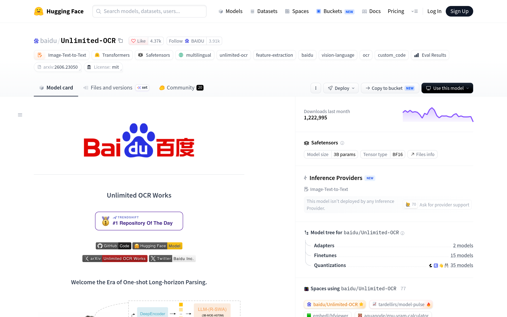

# 文档解析开源模型：Unlimited-OCR（百度）

## 直观预览

> Hugging Face 模型页（1440×900）：baidu/Unlimited-OCR，MIT，4.37k likes，月下载 122 万，3B 参数 BF16，Trendshift #1 Repository Of The Day。

## 一句话价值

百度的开源文档解析多模态模型：号称"one-shot 长视野解析"，单张图或多页 PDF 一次生成完整解析结果（带版式标记）；MIT、3B 参数、月下载 122 万——想把图片/PDF 转结构化文本，这是当前最热的开源选项之一。

## AI 选用指南

| 项目 | 选用说明 |
| --- | --- |
| 优先选用条件 | 需要把文档截图/PDF 转成结构化文本（版式保留）；长文档想一次解析完（32768 上下文）；要本地/自托管部署。 |
| 不适合或暂缓条件 | 需要在线 API 即用（HF 上无 Inference Provider，得自己部署）；NVIDIA GPU 推理，Mac/纯 CPU 不直接跑。 |
| 复用方式 | 直接调用（transformers / vLLM / SGLang）、部署服务 |
| 输入与产出 | 图片/PDF → 带版式标记的解析文本（OmniDocBench 评测口径）。 |
| 首次读取入口 | [本卡](./文档解析开源模型-Unlimited-OCR-2026-10-12.md) →「内容摘要」；模型页 https://huggingface.co/baidu/Unlimited-OCR；GitHub 仓库（代码）见模型页徽章。 |
| 同类选择依据 | 库内暂无同类文档解析模型；作者致谢 Deepseek-OCR / Deepseek-OCR-2 / PaddleOCR——选型时三者对比。 |
| 接入前提与待核实项 | MIT 许可；需要 GPU（transformers 要求 torch+CUDA；vLLM 有官方 docker `vllm/vllm-openai:unlimited-ocr`）；未实际部署验证。 |
| 检索词 | Unlimited-OCR 百度 OCR 文档解析 one-shot 长视野解析 document parsing |

> 核查记录：整理于 2026-10-12，基于 HF 模型卡 README 全文 + 模型 API 元数据（MIT/4.37k likes/月下载122万/3B）。未实际部署测试。

## 内容摘要

Unlimited-OCR（https://huggingface.co/baidu/Unlimited-OCR）是百度 2026-06-19 发布的开源视觉语言 OCR 模型，论文 arXiv:2606.23050《Unlimited OCR Works》。

- **核心卖点**：One-shot Long-horizon Parsing——单张图或多页 PDF 一次生成完整解析，输出带 `<|det|>` 版式标记（类型+bbox），后处理可转纯文本。
- **两种配置**：gundam（base_size=1024, image_size=640, crop_mode=True）/ base（image_size=1024, crop_mode=False）；多页/PDF 只用 base。
- **部署方式**：transformers（trust_remote_code）、vLLM（官方 docker `vllm/vllm-openai:unlimited-ocr`，Hopper 版 `unlimited-ocr-cu129`）、SGLang（OpenAI 兼容 API）、ms-swift 微调、ModelScope、百度云。
- **生态**：77 个 Spaces 在用；2 adapters / 15 finetunes / 35 quantizations；Trendshift #1 Repository Of The Day。
- **许可**：MIT。

## 为什么值得收藏

1. **xiegao2.0 的证据层**：选题核验要读 PDF/论文/截图文档，这个模型就是"把图变成可检索文本"的工具。
2. **MIT + 热度**：MIT 许可商用无忧；月下载 122 万、4.37k likes，生态成熟（vLLM/SGLang 官方支持）。
3. **长文档一次解析**：32768 上下文 + 多页 PDF 接口，适合整本 PDF 扔进去解析，不用自己切页。

## 未来可以怎么用

- xiegao2.0：选题核验时 PDF/截图文档先过这个模型转文本，再进 facts/claims 核验。
- bot 素材：长截图、网文图片转文本再打分。
- 服务器上用 vLLM docker 一键起服务，OpenAI 兼容接口接入现有 pipeline。

## 原始内容 / 链接

- 模型：https://huggingface.co/baidu/Unlimited-OCR（MIT，4.37k likes，2026-06-19 发布）
- 论文：arXiv:2606.23050
- vLLM 部署：https://recipes.vllm.ai/baidu/Unlimited-OCR
- 未实际部署验证。

## 相关联想

- [AI 设计选型方法论：Design with AI（AmirMušić）](../../03-Codex能力/Skills/AI设计选型方法论-Design-with-AI-2026-10-09.md)：按任务选模型的方法论——文档解析任务先看这个模型

## 适合反向调用的场景

- 有没有开源的文档解析模型？
- PDF/图片转结构化文本用什么模型？
- Deepseek-OCR 之外还有什么选择？
