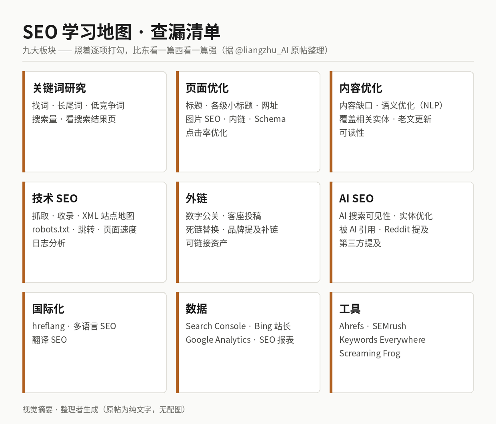

# SEO 学习地图：九大板块查漏清单

## 直观预览

> 视觉摘要（整理者按原帖内容生成）：九大板块的查漏地图。原帖为纯文字、无配图——"这张地图"指帖子正文本身的九段清单；公开接口与未登录浏览器两路核查均确认无附图，本图不是原帖素材。

## 一句话价值

一张把 SEO 全貌压成九个板块的查漏清单：关键词研究、页面优化、内容优化、技术 SEO、外链、AI SEO、国际化、数据、工具——价值不在新知，在完整：给自己的站做体检时照着逐项打勾，缺哪块一目了然，其中 AI SEO 被单列成一级板块是它跟上时代的地方。

## AI 选用指南

| 项目 | 选用说明 |
| --- | --- |
| 优先选用条件 | 给内容站/工具站做 SEO 自查或规划时，先用本卡九板块过一遍找缺口；给 wuyu.uk、stockmon 落地页这类自有站点排优化动作时，当目录用。 |
| 不适合或暂缓条件 | 本卡是查漏清单，不是教程：每个条目只有名字、没有做法和优先级，不能替代具体执行方案；中文平台内流量（抖音/小红书/微博）不适用这套谷歌 SEO 框架。 |
| 复用方式 | 套用清单（逐板块对照自有站点打勾）；与 [GEORank](../04-工具网站/开源项目/GEO开源工作台-GEORank-2026-07-18.md) 接力：本卡负责"查哪块缺"，GEORank 负责 AI 搜索可见性那块的"怎么查"。 |
| 输入与产出 | 输入：一个已上线站点 → 产出：按九板块列出的缺口清单，再逐项排执行顺序。 |
| 首次读取入口 | 本卡「内容摘要」的九板块表；原帖链接见原始内容节。 |
| 同类选择依据 | 库内此前只有工具向的 [GEORank](../04-工具网站/开源项目/GEO开源工作台-GEORank-2026-07-18.md)（AI 搜索可见性工作台），没有传统 SEO 的全景清单；本卡补的是框架层，GEORank 是其中 AI SEO 板块的执行工具，两者是目录与工具的关系，不互替。 |
| 接入前提与待核实项 | 清单为作者经验整理，非谷歌官方文档；条目时效性整体可靠（均为现行通用做法），但具体规则（如 Schema 类型、hreflang 细节）执行前查官方文档。原帖外链一节末尾括号未闭合，系原文笔误，摘要时已按语义补全并注明。 |
| 检索词 | SEO 学习地图、SEO 查漏、SEO 清单、关键词研究、页面优化、技术 SEO、外链建设、AI SEO、GEO、hreflang、国际化 SEO、Search Console、Ahrefs、Screaming Frog、SEO checklist、SEO roadmap |

> 核查记录：2026-11-03 经公开接口读原帖全文；另经未登录浏览器实地查看，确认帖子无附图、正文与接口文本一致（浏览 4931 / 赞 86 / 收藏 108）。帖子数据为查阅当日值。

## 内容摘要

### 原帖与作者

作者良竹（@liangzhu_AI，AI 创业者，产品出海 × FDE 实践）2026-11-02 发帖。开场白就是用法说明：这张 SEO 学习地图，照着查漏，比东看一篇西看一篇强。全文即地图本身，九个板块如下（每板块条目为原帖要点，仅做排版整理）：

| 板块 | 条目 |
| --- | --- |
| 关键词研究 | 找词、长尾词、低竞争词、搜索量、看搜索结果页 |
| 页面优化 | 标题、各级小标题、网址、图片 SEO、内链、结构化标记（Schema）、点击率优化 |
| 内容优化 | 找内容缺口、语义优化（NLP）、覆盖相关实体（人名/品牌/产品这类词）、老文更新、可读性 |
| 技术 SEO | 抓取、收录、XML 站点地图、robots.txt、跳转、页面速度、日志分析 |
| 外链 | 数字公关（做有传播度的内容换报道）、客座投稿、死链替换、没人链接的品牌提及、可链接资产（别人愿意引用的工具或内容） |
| AI SEO | AI 搜索里能不能被看到、实体优化、被 AI 引用、Reddit 提及、第三方提及 |
| 国际化 | hreflang（告诉谷歌哪个语言版本给哪个地区）、多语言 SEO、翻译 SEO |
| 数据 | Search Console、Bing 站长工具、Google Analytics、SEO 报表 |
| 工具 | Ahrefs、SEMrush、Keywords Everywhere、Screaming Frog |

### 深度注（整理者判断，与原帖分开）

- **骨架是行业共识，新意在两处**：前六块（研究→页面→内容→技术→外链→数据/工具）是十年来稳定的 SEO 分类学，任何权威教程都是这个骨架；这张图的当代性体现在把 **AI SEO 单列一级板块**（AI 搜索可见性、实体优化、被 AI 引用、Reddit 与第三方提及——本质就是 GEO）和**国际化单列**（作者是出海背景，hreflang 是多语言站的真痛点）。换句话说，它是一张"传统骨架 + 2025 年增量"的地图。
- **它缺的也要知道**：没有本地 SEO（商家档案）、没有把 E-E-A-T/品牌信号单列、Core Web Vitals 只藏在"页面速度"里、网站信息架构被拆散在页面与技术两块。拿它查漏可以，拿它当完整课程不够。
- **最大的使用陷阱**：清单没有优先级。九块全绿不现实，自查后要按"先技术收录（没收录一切免谈）→ 再关键词与内容 → 最后外链与 AI SEO"的顺序排，而不是平均用力。原帖说"照着查漏"是对的定位——查漏，不是路线图顺序。

## 为什么值得收藏

- 库里有 GEO 工具（GEORank）、有域名与出海的零散经验，唯独缺一张传统 SEO 的全景图；以后任何自有站点（wuyu.uk、stockmon、glint.red）做流量体检，先开这张图定缺口，再决定用哪个工具、查哪份文档。
- AI SEO 与国际化两个增量板块，正好对应用户正在推进的两条线：内容资产的 AI 搜索可见性、以及产品出海。
- 清单足够短：一屏看完、九个格子，符合"查漏表"该有的密度，不像教程那样读完就忘。

## 未来可以怎么用

- wuyu.uk Cat Blog 上线后跑一遍九板块自查：重点先落关键词研究（猫/宠物长尾词）、内容缺口与老文更新、内链结构三块。
- stockmon 落地页按页面优化板块逐项核：标题层级、Schema（Product/FAQ）、页面速度、点击率。
- AI SEO 板块与 GEORank 卡接力：用 GEORank 查 stockmon 与 xiegao 在 AI 搜索里的可见性，缺口回到本卡对照。
- 以后每新增一个自有站点，把九板块自查设为上线后第一个月的固定动作，结果记成该项目的检查记录。

## 原始内容 / 链接

- 原帖：https://x.com/liangzhu_AI/status/2117205326516605245 （2026-11-02 18:41 CST 发布；作者良竹 @liangzhu_AI）
- 帖子正文即本卡内容摘要的九板块表（原帖为分段文字，无配图、无外链）；外链一节末尾括号未闭合为原文笔误。

## 相关联想

- [GEO 开源工作台：GEORank](../04-工具网站/开源项目/GEO开源工作台-GEORank-2026-07-18.md)：本卡 AI SEO 板块的执行工具——地图给"查什么"，GEORank 给"怎么查 AI 可见性"。
- [开源动作工作室工具链：22 个库拼出代码化视频管线](../04-工具网站/开源项目/开源动作工作室工具链-22个库拼视频管线-2026-11-02.md)：同为"清单型"收藏，视频管线解决生产，SEO 地图解决被看见——内容生意的一前一后。
- 与域名巡查工作的关系：域名是出海的门牌，SEO 是门牌之后的路牌系统；选域名时"简单好记"的标准，本质也在服务这张图里的品牌提及与直接流量。

## 适合反向调用的场景

- 我最近收藏了哪些相关内容？
- 这个项目可以借用什么素材？
- 有没有类似表达、结构、做法可以复用？
- 给任何自有站点做流量/SEO 体检时，先开本卡九板块定缺口。
- 讨论 AI 搜索可见性（GEO）时，用本卡确认它在整个 SEO 盘子里的位置，再进 GEORank 卡。
