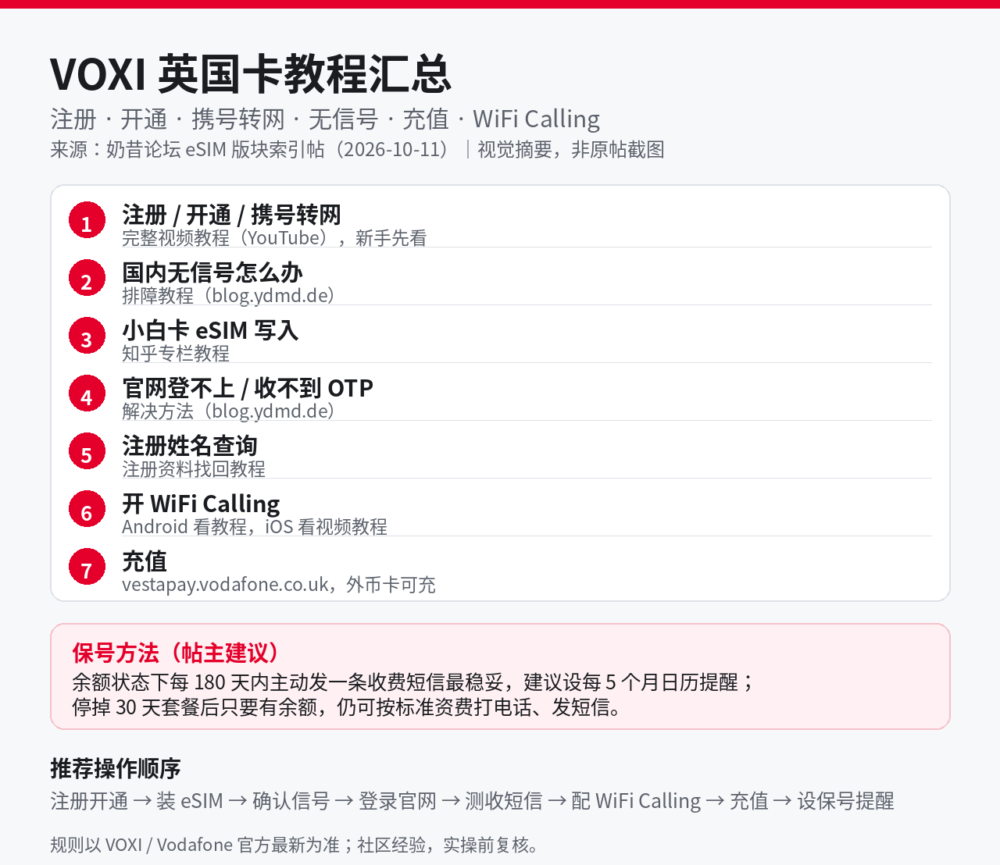

# VOXI 英国卡保号教程汇总：注册、携号转网、WiFi Calling 与 180 天保号

## 直观预览

> 上图为依据原帖目录整理的视觉摘要图（本地生成），不是原帖截图。原帖是奶昔论坛 eSIM 版块的一篇索引帖，本身无配图，正文聚合 7 个外部教程入口，并附保号方法与推荐操作顺序。

## 一句话价值

一篇帖子把 VOXI 英国卡从注册、携号转网到长期保号的全部实操入口聚齐了：在中国用英国号收验证码的人，照着它的操作顺序走、照着它的 180 天节奏保号，就是目前社区最成体系的一份操作手册。

## AI 选用指南

| 项目 | 选用说明 |
| --- | --- |
| 优先选用条件 | 正在把英国号码转入 VOXI 或已持有 VOXI 卡，需要按步骤完成注册开通、eSIM 安装、携号转网、WiFi Calling 配置、充值或长期保号时；遇到国内无信号、官网登录收不到 OTP 等具体故障需要排障入口时。 |
| 不适合或暂缓条件 | 需要 VOXI/Vodafone 官方规则原文（资费、条款、漫游政策）时——本帖是社区经验汇总，帖主自己也声明以官方最新为准，官方事项须回 VOXI 官网或客服确认；需要其他运营商（Lyca、Tesco、CTExcel 等）教程时本帖不覆盖。 |
| 复用方式 | 套用方法（操作顺序与保号节奏）、查询入口（7 个教程链接按故障类型分发） |
| 输入与产出 | 一张待开通或待转入的 VOXI eSIM + 旧号 PAC → 按「注册开通 → 装 eSIM → 确认信号 → 登录官网 → 测收短信 → 配 WiFi Calling → 充值 → 设保号提醒」的顺序完成转网，并落位每 5 个月一次的保号提醒。 |
| 首次读取入口 | [本卡](./VOXI英国卡保号教程汇总-2026-10-24.md) →「内容摘要」的操作顺序与保号方法；具体故障点开原帖对应教程链接（原帖见「原始内容 / 链接」）。 |
| 同类选择依据 | 库内暂无 VOXI 或其他英国运营商的保号/转网卡（2026-10-24 收录时全库查重确认），无同类可比；后续若收录其他运营商教程，按「官方口径是否明确、国内首激活是否可行、年保号成本」三项再做对比。 |
| 接入前提与待核实项 | 帖内 7 个外部教程链接（YouTube、blog.ydmd.de、知乎专栏等）的当前可访问性未逐一复核，点开失效时以原帖标题关键词另行检索；充值填法（号码去 +44 前加 0、邮编填任意真实英国邮编如 W5 2LD）为帖内经验，实操时以充值页实际校验为准；「180 天内发一条收费短信」是帖主建议的稳妥口径，与 VOXI 条款的断号节奏并不等同（见核查记录）。 |
| 检索词 | VOXI 保号 VOXI 携号转网 PAC WiFi Calling 无信号 收不到验证码 英国手机卡 eSIM Vodafone vestapay 充值 |

> 核查记录：整理于 2026-10-24。原帖全文已由收录方实际读取（奶昔论坛 tid=15967，2026-10-11 发布），帖内 7 个教程入口、保号方法、操作顺序、充值填法均为帖子原文信息，属「社区经验」层级。另据此前查得的 VOXI 条款口径：连续 180 天无充值/买套餐/收费活动先收到警告短信，再给 90 天宽限，满 270 天才断号——帖主「180 天内主动发一条收费短信」是比条款更保守的保号节奏，两者不要混为一谈。收藏本卡不证明已完成 VOXI 开户或转网。

## 内容摘要

原帖《VOXI eSIM UK 英国相关教程汇总｜注册、开通、携号转网、无信号、充值、WiFi Calling》是奶昔论坛 eSIM 版块的索引帖，聚合 7 个外部教程入口：

1. **注册 / 开通 / 携号转网完整视频教程**（YouTube）：新手先看这一条，覆盖从注册到 PAC 转入的全流程。
2. **国内无信号解决教程**（blog.ydmd.de）：在国内装上 eSIM 后搜不到信号时的排障。
3. **小白卡 eSIM 写入教程**（知乎专栏）：用实体小白卡承接 eSIM 的写入方法。
4. **官网无法登录 / 收不到 OTP 解决方法**（blog.ydmd.de）：登录 VOXI 官网时收不到验证码的解法。
5. **注册姓名查询教程**：注册资料（姓名等）遗忘时的找回方法。
6. **开启 WiFi Calling 教程**：Android 看这条，iOS 看第 1 条视频教程。
7. **充值**：官方充值页 vestapay.vodafone.co.uk，外币 Master/Visa 实体卡或虚拟卡可充；号码填法是去掉 +44、前面加 0；邮编填任意真实英国邮编（如 W5 2LD）。

**保号方法（帖主建议）**：在 PAYG/余额状态下，每 180 天以内主动发一条收费短信是最稳妥的保号动作，建议设每 5 个月一次的日历提醒；停掉 30 天套餐后只要账户有余额，仍可按标准资费打电话、发短信。

**推荐操作顺序**：注册/开通 → 安装 eSIM → 确认有信号 → 登录官网 → 测试收短信 → 配置 WiFi Calling → 充值余额 → 设置保号提醒。

**帖内免责**：规则以 VOXI/Vodafone 官方最新为准。

## 为什么值得收藏

1. **成体系，不是碎片**：单个教程帖到处都有，但把「开通—排障—保号」全链路聚成一张索引、还给出明确操作顺序的，目前就这一篇；实操时不用再四处翻帖。
2. **正对当前卡点**：无信号、WiFi Calling 拉起、登录收不到 OTP，恰好是国内用户办 VOXI 最容易卡住的三个环节，帖子里都有独立入口。
3. **保号节奏可直接执行**：「180 天内发一条收费短信 + 每 5 个月日历提醒」是能立刻落进提醒系统的具体动作，不是泛泛而谈。
4. **充值填法是隐性知识**：号码去 +44 加 0、邮编填真实英国邮编这类细节，官方页面不会教你，充值失败的人多半卡在这里。

## 未来可以怎么用

- **giffgaff 转网实操阶段当排障手册**：正把被 giffgaff 封停的英国号（+44 7395974734，PAC 有效期至 2026-11-20）转入 VOXI 保号；转网当天的开通、装卡、测短信、WiFi Calling 拉起按原帖顺序走，出问题按故障类型点对应教程。
- **保号长期维护**：转网完成后按帖主节奏设每 5 个月提醒，发一条收费短信保号；每次 VOXI 规则有变动时，回这张卡对照官方口径复核。
- **以后再办英国卡时复用**：注册姓名查询、vestapay 充值填法、小白卡写入这些环节对其他 Vodafone 系品牌也有参考价值。
- **给别人答疑时转发**：有人问 VOXI 怎么开通/保号，直接发原帖链接加本卡的操作顺序，比口头解释快。

## 原始内容 / 链接

- 原帖：https://forum.naixi.net/forum.php?mod=viewthread&tid=15967
- 标题：VOXI eSIM UK 英国相关教程汇总｜注册、开通、携号转网、无信号、充值、WiFi Calling
- 来源平台：奶昔论坛（forum.naixi.net）eSIM 版块；发布：2026-10-11
- 帖内主要外链：YouTube 视频教程、blog.ydmd.de 两篇排障文、知乎专栏（小白卡写入）、VOXI 官方充值页 vestapay.vodafone.co.uk（具体外链地址见原帖，收录时未逐一复核可访问性）

## 相关联想

- giffgaff 封号后的英国号保号选型：VOXI 是社区共识最强的接棒者（WiFi Calling 国内可直拉、停套餐后余额保号），本帖是这条路线的操作层配套；运营商选型层面的比较（eSIM.net、Tesco 转寄、CTExcel 等）不在本卡范围。
- 「靠定期活动续命」的资产不止手机卡：域名、海外账号、会员资格都有类似的活跃度规则，可以共用一套「提前一个月提醒 + 最小动作保号」的巡检节奏。
- 小白卡/9eSIM 这类实体承接卡：eSIM 写入教程对其他只发 eSIM 的海外运营商同样适用，是出国通信工具箱的通用件。

## 适合反向调用的场景

- 我要把英国号码转入 VOXI，完整步骤是什么？哪一步最容易卡住？
- VOXI 在国内没信号 / 收不到登录验证码怎么办？
- VOXI 怎么保号？多久要动一次？提醒怎么设？
- VOXI 充值页面在哪？外币卡怎么填号码和邮编？
